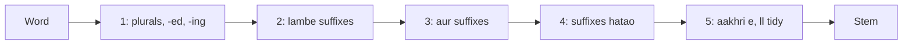

**In simple words:** Porter stemmer chhote rules ke set se word endings kaat deta hai, isliye connect, connected aur connecting sab ban jaate hain connect.

**Definition:** stemming is a simplified form of morphological analysis used to find the root word. Porter stemmer is a simple rule-based algorithm for stemming, jisme 5 sets of rules hain, aur wo speed aur simplicity ke liye jaana jaata hai. Ye English words se suffixes hataata hai, jo information retrieval mein terms ki sankhya kam karta hai (space aur time bachta hai). Ise Martin F. Porter ne banaya. <Cite id="class-nlp-m2" loc="p. 19" /> <Cite id="class-nlp-pyq2" loc="p. 2" />

**Consonants aur vowels:** consonant wo letter hai jo a, e, i, o, u nahi hai aur wo y nahi hai jo consonant ke baad aaya ho; baaki har letter vowel hai. C matlab consonants ki string aur V vowels ki string. <Cite id="class-nlp-pyq2" loc="p. 2" />

**Form aur measure:** har word $[C](VC)^m[V]$ hota hai, aur $m$ (measure) VC pairs ki sankhya hai. TREE ka m = 0, TROUBLE aur TRAP ka m = 1, TROUBLES aur PRIVATE ka m = 2, RELATIONAL ka m = 4. <Cite id="class-nlp-m2" loc="p. 20" /> <Cite id="class-nlp-m2" loc="p. 21" />

**Rule form:** (condition) S1 to S2. Agar word S1 par khatam ho aur S1 se pehle ka stem condition poori kare, to S1 ko S2 se badlo. Example: (m > 1) EMENT to nothing se REPLACEMENT ban jaata hai REPLAC, kyunki REPLAC ka m = 2 hai. <Cite id="class-nlp-pyq2" loc="p. 3" />

**Main rules** (standard; class files sirf rule form deti hain): 1a SSES to SS, IES to I, S to nothing (caresses se caress, ponies se poni, cats se cat); 1b (stem has a vowel) ED ya ING to nothing (motoring se motor); 2 (m > 0) ATIONAL to ATE (relational se relate); 3 (m > 0) FUL to nothing (hopeful se hope); 4 (m > 1) EMENT, MENT, AL aur doosre to nothing (replacement se replac); 5 (m > 1) E to nothing (relate se relat).

**Example:** generalizations: 1a se generalization, 2 (IZATION to IZE) se generalize, 3 (ALIZE to AL) se general, 4 (AL to nothing) se **gener**.

**Conclusion:** Porter stemmer fast aur simple hai, par crude hai: stem dictionary word hona zaroori nahi (happy ban jaata hai happi).
