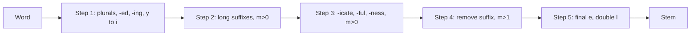

**In simple words:** **stemming** cuts the ending off a word so that related forms (*connect, connected, connecting, connection*) become one stem (*connect*). The **Porter stemmer** (Martin Porter, 1980) does this with a small set of suffix rules in five steps, without a dictionary. The stem need not be a real word (*happy* becomes *happi*). <Cite id="porter-stemmer-def" /> <Cite id="text-preprocessing-porter1980" /> <Cite id="porter-stemmer-wiki-stem" />

**Why it is needed.** In search, a query for *connect* should also find *connected*. Stemming also shrinks the vocabulary. <Cite id="porter-stemmer-gfg-stemming" />

**Measure m.** A letter is a vowel if it is a, e, i, o, u, or a y after a consonant; otherwise it is a consonant. Every word has the form $[C](VC)^m[V]$, where C is a run of consonants and V a run of vowels. The number $m$ counts the VC pairs: *tree* $m=0$, *trouble* $m=1$, *private* $m=2$. A rule fires only if the stem left has enough length, tested through $m$. <Cite id="porter-stemmer-def" loc="§2" />

**Rule form:** (condition) S1 to S2: if the word ends in S1 and the stem satisfies the condition, replace S1 by S2. In a group, only the rule with the **longest matching** S1 is used.

<Cite id="porter-stemmer-snowball" loc="the steps" />

| Step | What it does | Example |
|---|---|---|
| 1a | Plurals: SSES to SS, IES to I, SS stays, S removed | caresses to caress, ponies to poni, cats to cat |
| 1b | (m>0) EED to EE; remove ED or ING if the stem has a vowel, then tidy (AT to ATE, BL to BLE, IZ to IZE, double letter to one, short word add E) | agreed to agree, hopping to hop |
| 1c | (stem has a vowel) Y to I | happy to happi |
| 2 | m>0: ATIONAL to ATE, IZATION to IZE, BILITI to BLE ... | relational to relate |
| 3 | m>0: ICATE to IC, ALIZE to AL, ATIVE, FUL, NESS removed | goodness to good |
| 4 | m>1: remove AL, ANCE, ER, IC, ABLE, ANT, MENT, ION (after S or T) ... | allowance to allow, adoption to adopt |
| 5 | (m>1) final E removed; (m>1, double L) one L | probate to probat, controll to control |

<Sum>

<Given>

The words *generalizations*, *relational*, *hopping*, *happiness*.

</Given>

<Find>

the stem of each by the original Porter rules.

</Find>

<Steps>

1. **generalizations.** 1a: S removed, *generalization*. 2: IZATION to IZE (stem *general* has $m>0$), *generalize*. 3: ALIZE to AL (stem *gener*, $m=2$), *general*. 4: AL removed (stem *gener* has $m=2>1$), *gener*. 5: no final E. Result **gener**.
2. **relational.** 1: no change. 2: ATIONAL to ATE (stem *rel*, $m=1>0$), *relate*. 3: no rule. 4: ATE needs $m>1$ but *rel* has $m=1$, so it stays. 5a: remove E because *relat* has $m=2>1$. Result **relat**.
3. **hopping.** 1b: remove ING (stem *hopp* has a vowel), *hopp*; clean-up: double consonant p becomes one, *hop*. Later steps do nothing. Result **hop**.
4. **happiness.** 1a: ends in SS, unchanged. 3: NESS removed (stem *happi*, $m=1>0$), *happi*. Result **happi**.

</Steps>

<Answer>

gener, relat, hop, happi.

</Answer>

<Box kind="verify">

Check against NLTK's original Porter mode: generalizations gives gener, relational gives relat, hopping gives hop and happiness gives happi. Measure check: *gener* is C V C V C so $m=2$; *rel* is C V C so $m=1$.

</Box>

</Sum>

**Errors.** Over-stemming: *university* and *universe* both go to *univers*. Under-stemming: *alumnus* and *alumni* stay different. The stem may be a non-word.

**Advantages:** fast, simple, no dictionary, standard for English search. **Disadvantages:** English only, crude errors, non-word stems. Better: lemmatization (dictionary) or Snowball (Porter2). <Cite id="porter-stemmer-av-stemming" />
