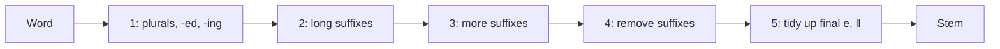

**In simple words:** the Porter stemmer cuts word endings with a small set of rules, so connect, connected and connecting all become connect.

**Definition:** stemming is a simplified form of morphological analysis used to find the root word. The Porter stemmer is a simple rule-based algorithm for stemming, with 5 sets of rules, known for its speed and simplicity. It removes suffixes from English words, which helps information retrieval by reducing the number of terms (saving space and time). Developed by Martin F. Porter. <Cite id="class-nlp-m2" loc="p. 19" /> <Cite id="class-nlp-pyq2" loc="p. 2" />

**Consonants and vowels:** a consonant is a letter other than a, e, i, o, u and other than y preceded by a consonant; every other letter is a vowel. C means a string of consonants and V a string of vowels. <Cite id="class-nlp-pyq2" loc="p. 2" />

**Form and measure:** every word is $[C](VC)^m[V]$, and $m$ (the measure) is the number of VC pairs. TREE has m = 0, TROUBLE and TRAP m = 1, TROUBLES and PRIVATE m = 2, RELATIONAL m = 4. <Cite id="class-nlp-m2" loc="p. 20" /> <Cite id="class-nlp-m2" loc="p. 21" />

**Rule form:** (condition) S1 to S2. If the word ends with S1 and the stem before S1 meets the condition, replace S1 with S2. Example: (m > 1) EMENT to nothing makes REPLACEMENT into REPLAC, since REPLAC has m = 2. <Cite id="class-nlp-pyq2" loc="p. 3" />

**Main rules** (standard; the class files give only the rule form): 1a SSES to SS, IES to I, S to nothing (caresses becomes caress, ponies becomes poni, cats becomes cat); 1b (stem has a vowel) ED or ING to nothing (motoring becomes motor); 2 (m > 0) ATIONAL to ATE (relational becomes relate); 3 (m > 0) FUL to nothing (hopeful becomes hope); 4 (m > 1) EMENT, MENT, AL and others to nothing (replacement becomes replac); 5 (m > 1) E to nothing (relate becomes relat).

**Example:** generalizations: 1a gives generalization, 2 (IZATION to IZE) gives generalize, 3 (ALIZE to AL) gives general, 4 (AL to nothing) gives **gener**.

**Conclusion:** the Porter stemmer is fast and simple, but it is crude: the stem need not be a dictionary word (happy becomes happi).
