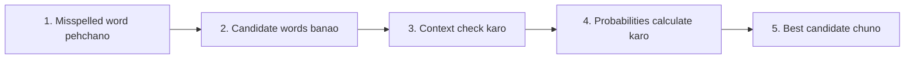

**In simple words:** N-gram model galat word ke aas-paas ke words se sahi spelling chunta hai. <Cite id="class-nlp-pyq2" loc="p. 8" />

| Candidate | Bigram | Probability |
|---|---|---|
| school | to school | high |
| stool | to stool | lower |
| skill | to skill | lower |

Example: "I want to go to skul". Bigram model to school, to stool aur to skill ko compare karta hai, aur **school** chunta hai. <Cite id="class-nlp-pyq2" loc="p. 8" />

**Conclusion:** jis candidate ki N-gram probability apne context mein sabse high ho wahi correction hai.
