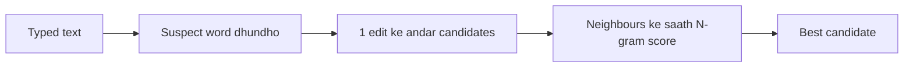

**In simple words:** N-gram model batata hai ki pichle words ke baad ek word kitna likely hai. Spelling corrector isse kai possible corrections mein se wo choose karta hai jo sentence mein sabse achha fit hota hai. <Cite id="ngram-language-models-slp3-ch3" />

**Spelling error ke do kinds**

- **Non-word error:** typed word dictionary mein hai hi nahi ("graffe"). Dictionary ise pakad leti hai.
- **Real-word error:** typed word valid hai lekin yahan galat hai ("a **peace** of cake"). Ise sirf aas-paas ke words se pakda ja sakta hai, isliye N-gram model chahiye. <Cite id="ngram-language-models-wiki-spell" />

**Steps (noisy channel idea)** <Cite id="ngram-language-models-kernighan1990" />

1. Suspect word dhundho.
2. Ek edit ke andar **candidates** banao (letter insert, delete, replace ya swap), jaise *pece* se *piece*, *peace*.
3. Har candidate ko score do: $P(\text{candidate}) \times P(\text{typo} \mid \text{candidate})$. Doosra part batata hai ki ye typing slip kitni likely hai.
4. $P(\text{candidate})$ bigram model se aata hai: $P(w_i \mid w_{i-1}) = C(w_{i-1}w_i)/C(w_{i-1})$. Agle word ke bigram se bhi multiply karo.
5. Sabse high score wala choose karo.

**Example** (invented counts, sirf method dikhane ke liye) "a **pece** of cake" ke liye:

| Candidate | $P(w \mid a)$ | $P(\text{of} \mid w)$ | Product |
|---|---|---|---|
| piece | 40/10000 = 0.004 | 30/50 = 0.6 | 0.0024 |
| peace | 2/10000 = 0.0002 | 5/100 = 0.05 | 0.00001 |

Typing-slip wala hissa $P(\text{typo} \mid \text{candidate})$ yahan dono ke liye barabar maana hai, isliye winner nahi badalta. *piece* jeet jaata hai, kyunki "a piece of" "a peace of" se bahut zyada common hai. <Cite id="ngram-language-models-gfg-spellcheck" />

**Conclusion:** N-gram model context probability deta hai, aur best correction wo candidate hai jiska combined score sabse high hai.
