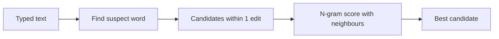

**In simple words:** an N-gram model tells how likely a word is after the words before it. A spelling corrector uses this to pick, from several possible corrections, the one that fits the sentence best. <Cite id="ngram-language-models-slp3-ch3" />

**Two kinds of spelling error**

- **Non-word error:** the typed word is not in the dictionary ("graffe"). A dictionary finds it.
- **Real-word error:** the typed word is valid but wrong here ("a **peace** of cake"). Only the surrounding words can catch it, so an N-gram model is needed. <Cite id="ngram-language-models-wiki-spell" />

**Steps (noisy channel idea)** <Cite id="ngram-language-models-kernighan1990" />

1. Find the suspect word.
2. Make **candidates** within one edit (insert, delete, replace or swap a letter), for example *pece* gives *piece*, *peace*.
3. Score each candidate: $P(\text{candidate}) \times P(\text{typo} \mid \text{candidate})$. The second part says how likely this typing slip is.
4. $P(\text{candidate})$ comes from the bigram model: $P(w_i \mid w_{i-1}) = C(w_{i-1}w_i)/C(w_{i-1})$. Multiply it with the next word's bigram too.
5. Choose the highest score.

**Example** (invented counts, only to show the method) for "a **pece** of cake":

| Candidate | $P(w \mid a)$ | $P(\text{of} \mid w)$ | Product |
|---|---|---|---|
| piece | 40/10000 = 0.004 | 30/50 = 0.6 | 0.0024 |
| peace | 2/10000 = 0.0002 | 5/100 = 0.05 | 0.00001 |

The typing-slip part $P(\text{typo} \mid \text{candidate})$ is taken as equal for both here, so it does not change the winner. *piece* wins, because "a piece of" is far more common than "a peace of". <Cite id="ngram-language-models-gfg-spellcheck" />

**Conclusion:** the N-gram model gives the context probability, and the best correction is the candidate with the highest combined score.
