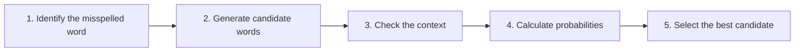

**In simple words:** an N-gram model uses the words around a wrong word to pick the right spelling. <Cite id="class-nlp-pyq2" loc="p. 8" />

| Candidate | Bigram | Probability |
|---|---|---|
| school | to school | high |
| stool | to stool | lower |
| skill | to skill | lower |

Example: "I want to go to skul". The bigram model compares to school, to stool and to skill, and picks **school**. <Cite id="class-nlp-pyq2" loc="p. 8" />

**Conclusion:** the candidate with the highest N-gram probability in its context is the correction.
