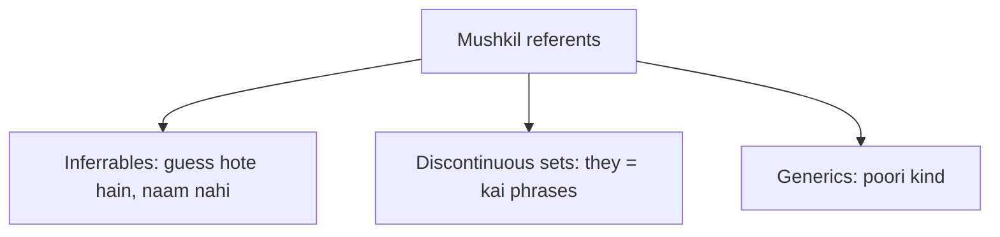

**In simple words:** teen kinds ke referents program ke liye mushkil hain, kyunki wo pehle naam liya gaya ek simple noun nahi hote. *(Class files mein ye question cover nahi hai; answer chhota aur standard hai.)*

1. **Inferrables:** referent ka kabhi naam nahi liya gaya, par kisi mention hui cheez se guess ho sakta hai. "I bought a **car**. **The engine** is loud." Engine car ka hai.
2. **Discontinuous sets:** ek plural pronoun kai alag noun phrases ko point karta hai. "**Ram** met **Sita**. **They** went home." *They* matlab Ram aur Sita saath mein, aur koi ek pehla phrase ye nahi kehta.
3. **Generics:** pronoun ek poori kind ko mean karta hai, pehle mention hui kisi particular cheez ko nahi. "I saw **bears** in the forest. **They** are dangerous." Yahan *They* matlab aam taur pe bears.

**Why hard:** aam method pronoun se agree karne wala ek pehla noun dhoondhta hai; in cases mein aisa noun nahi hota.

**Conclusion:** inferrables, discontinuous sets aur generics simple rule "pronoun = sabse paas ka pehla noun" ko tod dete hain.
