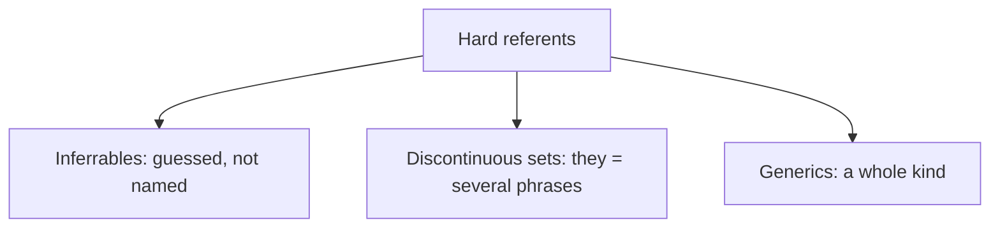

**In simple words:** three kinds of referents are hard for a program because they are not one simple noun that was named before. *(The class files do not cover this question; the answer is short and standard.)*

1. **Inferrables:** the referent was never named, but it can be guessed from something that was. "I bought a **car**. **The engine** is loud." The engine belongs to the car.
2. **Discontinuous sets:** one plural pronoun points to several separate noun phrases. "**Ram** met **Sita**. **They** went home." *They* means Ram and Sita together, and no single earlier phrase says that.
3. **Generics:** the pronoun means a whole kind, not a particular thing mentioned before. "I saw **bears** in the forest. **They** are dangerous." Here *They* means bears in general.

**Why hard:** the usual method looks for one earlier noun that agrees with the pronoun; these cases have none.

**Conclusion:** inferrables, discontinuous sets and generics break the simple rule "pronoun = nearest earlier noun".
