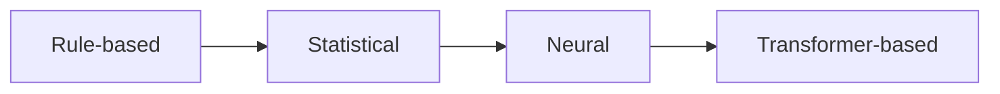

**In simple words:** machine translation system banane ke chaar tareeke hain: rules, statistics, neural networks aur Transformers. <Cite id="class-nlp-m6" loc="slides 3-6" />

| Approach | Kaise kaam karta hai |
|---|---|
| Rule-based (RBMT) | manually bane grammar rules, bilingual dictionaries, morphological analysis aur transfer rules |
| Statistical (SMT) | parallel corpora se seekhi translations ki probabilities; IBM models, language models, phrase-based models |
| Neural (NMT) | deep networks data se translation seekhte hain: RNN, LSTM, GRU, encoder-decoder, attention |
| Transformer-based | self-attention, parallel processing, context-aware translation |

<Cite id="class-nlp-m6" loc="slide 3" /><Cite id="class-nlp-m6" loc="slide 4" /><Cite id="class-nlp-m6" loc="slide 5" /><Cite id="class-nlp-m6" loc="slide 6" />

**Conclusion:** modern systems aam taur pe Transformer-based NMT use karte hain kyunki ye long-range relationships pakadta hai aur parallel train hota hai.
