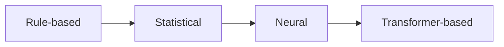

**In simple words:** there are four ways to build a machine translation system: rules, statistics, neural networks and Transformers. <Cite id="class-nlp-m6" loc="slides 3-6" />

| Approach | How it works |
|---|---|
| Rule-based (RBMT) | manually created grammar rules, bilingual dictionaries, morphological analysis and transfer rules |
| Statistical (SMT) | probabilities of translations learned from parallel corpora; IBM models, language models, phrase-based models |
| Neural (NMT) | deep networks learn translation from data: RNN, LSTM, GRU, encoder-decoder, attention |
| Transformer-based | self-attention, parallel processing, context-aware translation |

<Cite id="class-nlp-m6" loc="slide 3" /><Cite id="class-nlp-m6" loc="slide 4" /><Cite id="class-nlp-m6" loc="slide 5" /><Cite id="class-nlp-m6" loc="slide 6" />

**Conclusion:** modern systems commonly use Transformer-based NMT because it captures long-range relationships and trains in parallel.
