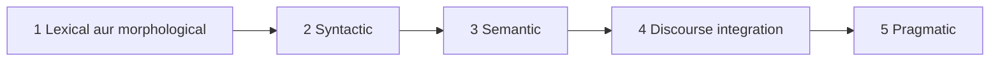

**In simple words:** computer sentence ko ek jump mein nahi samajhta. NLP stages mein kaam karta hai, aur har stage pichle stage ka output use karta hai. <Cite id="nlp-introduction-gfg-phases" />

<Cite id="nlp-introduction-gfg-phases" loc="diagram" />

1. **Lexical and morphological analysis.** Text ko words mein todo aur har word ko parts (stem aur affixes) mein todo: *unhappiness* matlab *un* + *happy* + *ness*.
2. **Syntactic analysis (parsing).** Grammar check karo aur parse tree banao. "Ravi eats mango" theek hai; "Eats Ravi mango the" reject hota hai. <Cite id="nlp-introduction-tp-nlp" />
3. **Semantic analysis.** Sentence ka meaning nikaalo. "Hot ice-cream" grammatical hai lekin uska koi sensible meaning nahi, isliye reject.
4. **Discourse integration.** Pichle sentences se is sentence ko samjho. "Ravi bought a book. He liked it." mein *He* = Ravi aur *it* = book.
5. **Pragmatic analysis.** Real situation mein intended meaning nikaalo. "Can you pass the salt?" ek polite request hai, ability ka sawaal nahi. <Cite id="nlp-introduction-ibm-nlp" />

**Conclusion:** NLP words se grammar, meaning, context aur intention tak jaata hai, aur paanchon stages milkar raw text ko understanding mein badalte hain.

Exam mein English mein likho: "The stages of NLP are lexical and morphological, syntactic, semantic, discourse and pragmatic analysis."
