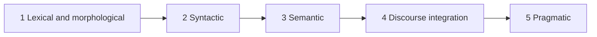

**In simple words:** a computer does not understand a sentence in one jump. NLP works in stages, and each stage uses the output of the one before. <Cite id="nlp-introduction-gfg-phases" />

<Cite id="nlp-introduction-gfg-phases" loc="diagram" />

1. **Lexical and morphological analysis.** Split the text into words and break each word into parts (stem and affixes): *unhappiness* is *un* + *happy* + *ness*.
2. **Syntactic analysis (parsing).** Check the grammar and build a parse tree. "Ravi eats mango" is fine; "Eats Ravi mango the" is rejected. <Cite id="nlp-introduction-tp-nlp" />
3. **Semantic analysis.** Find the meaning of the sentence. "Hot ice-cream" is grammatical but has no sensible meaning, so it is rejected.
4. **Discourse integration.** Use the earlier sentences to understand this one. In "Ravi bought a book. He liked it.", *He* = Ravi and *it* = the book.
5. **Pragmatic analysis.** Find the intended meaning in the real situation. "Can you pass the salt?" is a polite request, not a question about ability. <Cite id="nlp-introduction-ibm-nlp" />

**Conclusion:** NLP moves from words to grammar to meaning to context to intention, and the five stages together turn raw text into understanding.
