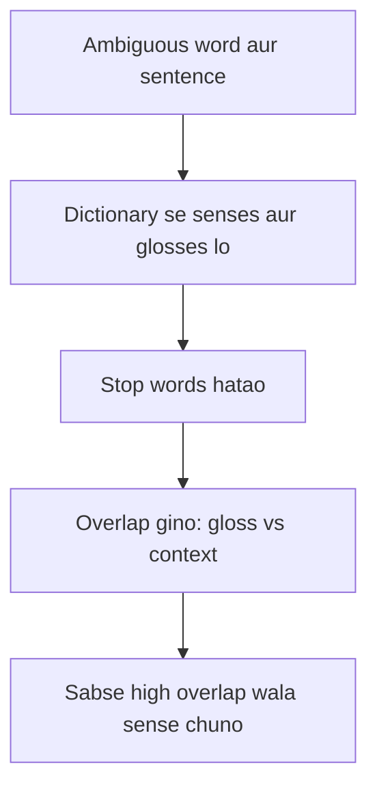

**In simple words:** bahut se words ke kai meanings hote hain. **Word Sense Disambiguation (WSD)** ka kaam hai context se word ka sahi meaning (sense) choose karna. "He sat on the river **bank**" mein *bank* ka matlab nadi ke kinare ki zameen hai, money bank nahi. <Cite id="word-sense-disambiguation-gfg-wsd" /> <Cite id="word-sense-disambiguation-slp3-I" />

**Ye kyun zaroori hai:** machine translation ko sahi target word chunna hota hai, search ko sahi pages dene hote hain, aur question answering ko question samajhna hota hai. <Cite id="word-sense-disambiguation-tp-wsd" />

**Dictionary-based (knowledge-based) approach.** Isme training data nahi lagta. Ye dictionary ya thesaurus (jaise WordNet) use karta hai, jisme har word ke senses ek chhoti definition (**gloss**) ke saath likhe hote hain. Idea ye hai ki sahi sense ke gloss mein wo words hote hain jo context mein bhi hain. Sabse famous method **Lesk algorithm** (1986) hai. <Cite id="word-sense-disambiguation-wiki-lesk" /> <Cite id="word-sense-disambiguation-wiki-wordnet" />

1. Ambiguous word lo aur uske saare senses glosses ke saath likho.
2. Uske aas-paas ke context words ikattha karo. Stop words (*the, of, on*) hata do.
3. Har sense ke liye overlap gino: uske gloss aur context ke beech common content words.
4. Sabse bada overlap wala sense chuno. Agar sab 0 hain, to sabse common sense le lo.

<Sum>

<Given>

sentence: "He sat on the **bank** of the river and watched the water flow." Senses (chhote WordNet-style glosses): bank#1 = "sloping land beside a body of water"; bank#2 = "a financial institution that accepts deposits and lends money".

</Given>

<Find>

*bank* ka sense.

</Find>

<Steps>

1. Context ke content words (stop words aur target hata ke): *sat, river, watched, water, flow*.
2. bank#1 ka gloss: *sloping, land, beside, body, water*. Context ke saath common: *water*, to overlap $=1$.
3. bank#2 ka gloss: *financial, institution, accepts, deposits, lends, money*. Context ke saath common: koi nahi, to overlap $=0$.
4. $1 > 0$, isliye bank#1 chuno.

</Steps>

<Answer>

*bank* = paani ke kinare ki dhalwaan zameen (bank#1).

</Answer>

<Box kind="verify">

Doosri taraf se recount: 5 context words mein se sirf *water* kisi gloss mein aata hai, aur sirf bank#1 mein. "river" aur "water" padhke insaan bhi wahi sense chunega.

</Box>

</Sum>

**Limits:** glosses chhote hote hain, isliye overlap aksar 0 ya tie hota hai; word forms alag hote hain (*deposits* vs *deposited*) jab tak stemming na ho; Extended Lesk related words ke glosses bhi jodke ise fix karta hai.

**Conclusion:** dictionary-based approach wo sense chunta hai jiski definition context ke saath sabse zyada overlap karti hai.
