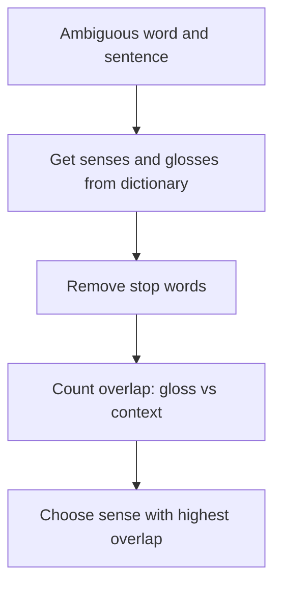

**In simple words:** many words have several meanings. **Word Sense Disambiguation (WSD)** is the task of choosing the correct meaning (sense) of a word from its context. In "He sat on the river **bank**", *bank* means land beside a river, not a money bank. <Cite id="word-sense-disambiguation-gfg-wsd" /> <Cite id="word-sense-disambiguation-slp3-I" />

**Why it is needed:** machine translation must pick the right target word, search must return the right pages, and question answering must understand the question. <Cite id="word-sense-disambiguation-tp-wsd" />

**Dictionary-based (knowledge-based) approach.** It uses no training data. It uses a dictionary or thesaurus such as WordNet, which lists the senses of each word with a short definition (**gloss**). The idea is that the correct sense has a gloss that shares words with the context. The best known method is the **Lesk algorithm** (1986). <Cite id="word-sense-disambiguation-wiki-lesk" /> <Cite id="word-sense-disambiguation-wiki-wordnet" />

1. Take the ambiguous word and list all its senses with glosses.
2. Collect the context words around it. Remove stop words (*the, of, on*).
3. For each sense, count the overlap: common content words between its gloss and the context.
4. Pick the sense with the largest overlap. If all are 0, fall back to the most common sense.

<Sum>

<Given>

sentence: "He sat on the **bank** of the river and watched the water flow." Senses (shortened WordNet-style glosses): bank#1 = "sloping land beside a body of water"; bank#2 = "a financial institution that accepts deposits and lends money".

</Given>

<Find>

the sense of *bank*.

</Find>

<Steps>

1. Context content words (stop words and the target removed): *sat, river, watched, water, flow*.
2. Gloss of bank#1: *sloping, land, beside, body, water*. Common with context: *water*, so overlap $=1$.
3. Gloss of bank#2: *financial, institution, accepts, deposits, lends, money*. Common with context: none, so overlap $=0$.
4. $1 > 0$, so choose bank#1.

</Steps>

<Answer>

*bank* = sloping land beside water (bank#1).

</Answer>

<Box kind="verify">

Recount the other way: of the 5 context words only *water* appears in any gloss, and only in bank#1. A human reading "river" and "water" gives the same sense.

</Box>

</Sum>

**Limits:** glosses are short, so overlap is often 0 or ties; word forms differ (*deposits* vs *deposited*) unless stemmed; Extended Lesk adds glosses of related words to fix this.

**Conclusion:** the dictionary-based approach picks the sense whose definition overlaps most with the context.
