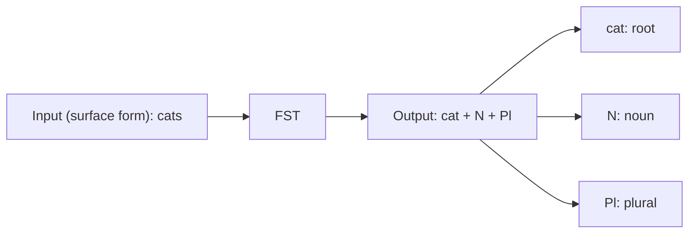

**In simple words:** morphological analysis word ko root plus tags mein badalta hai; finite state transducer (FST) wo machine hai jo ye badalne ka kaam karti hai.

**Morphological analysis ka output** (lemma + tags) <Cite id="class-nlp-pyq2" loc="p. 9" />

| Word type | Input word | Morphological analysis (output) |
|---|---|---|
| Regular verb | walked | walk + V + Past |
| Irregular verb | went | go + V + Past |
| Singular noun | cat | cat + N + Sg |
| Plural noun | cats | cat + N + Pl |

Went se go isliye milta hai kyunki irregular form ka lemma go hai, isliye analyser ko dictionary chahiye. <Cite id="class-nlp-pyq2" loc="p. 9" />

**FST:** FSA ka extension jo input sequences ko output sequences se map karta hai. FSA sirf accept ya reject karta hai; FST transform karta hai. Har transition par ek input symbol aur ek output symbol hota hai. $T = (Q, \Sigma, \Gamma, q_0, F)$: $Q$ states, $\Sigma$ input alphabet, $\Gamma$ output alphabet, $q_0$ initial state, $F$ final states. <Cite id="class-nlp-pyq2" loc="p. 9" />

**Morphological parsing mein role:** ye word ke surface form ko uske morphological representation se map karta hai (root ya stem plus noun, verb, singular, plural, tense): surface word, phir FST, phir morphological analysis. <Cite id="class-nlp-pyq2" loc="p. 10" />

**Example:** cats andar jaata hai aur cat + N + Pl bahar aata hai, jahan cat root hai, N noun hai aur Pl plural hai. <Cite id="class-nlp-pyq2" loc="p. 10" />

**Conclusion:** FST kaam ki dono directions deta hai: parsing ke liye word se analysis, aur generation ke liye analysis se word.
