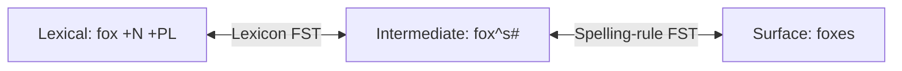

**In simple words:** morphological analysis (morphological parsing) word ko jaise likha hai (**surface form**) wahan se uska **stem** aur grammar tags nikaalta hai. **Finite state transducer (FST)** wo machine hai jo ye karti hai: ye ek string padhti hai aur doosri likhti hai. <Cite id="morphology-fst-gfg-morph" /> <Cite id="morphology-fst-wiki-fst" />

**Morphological analysis ka output**

| Word type | Surface form | Output |
|---|---|---|
| Regular verb | `walked` | `walk +V +PAST` |
| Regular verb | `walking` | `walk +V +PRES-PART` |
| Irregular verb | `caught` | `catch +V +PAST` |
| Irregular verb | `went` | `go +V +PAST` |
| Singular noun | `cat` | `cat +N +SG` |
| Plural noun | `cats` | `cat +N +PL` |
| Plural noun (irregular) | `geese` | `goose +N +PL` |

Regular forms rule se split hote hain (*walk* + *-ed*). Irregular forms mein suffix dikhta nahi, isliye unhe lexicon mein store karte hain. <Cite id="morphology-fst-wiki-irregular" />

**FST ka role.** Do chhote FSTs ek ke baad ek lagate hain. Har arrow `input:output` likha jaata hai. <Cite id="morphology-fst-jm-ch3-notes" /> <Cite id="morphology-fst-kaplan-kay" />

1. **Lexicon FST:** lexical form (stem + tags) ko intermediate form se jodta hai. `^` morpheme boundary hai aur `#` word ka end.
2. **Spelling-rule FST:** boundary pe spelling theek karta hai, jaise x, s, z ke baad *e* insert karna (`fox^s#` se `foxes`).

<Sum>

<Given>

surface word `foxes` (parsing direction).

</Given>

<Find>

uska morphological output.

</Find>

<Steps>

1. Spelling-rule FST ulta: surface `foxes` mein x aur *s* ke beech *e* hai, to *e*-insertion rule undo hota hai: `fox^s#`. *Reason: e sirf x, s ya z ke baad plural s se pehle aata hai.*
2. Lexicon FST ulta: `fox` lexicon mein noun stem hai aur `^s#` plural suffix hai, to output `fox +N +PL`.

</Steps>

<Answer>

`foxes` ka output `fox +N +PL`.

</Answer>

<Box kind="verify">

Seedha chalao: `fox +N +PL` se `fox^s#`, aur phir x ke baad s hone ki wajah se `foxes`. Hum wahi word wapas paate hain jisse shuru kiya tha.

</Box>

</Sum>

**FST kyun:** ek hi machine dono directions mein kaam karti hai (analysis aur generation), tez hai, aur wahi lexicon dobara use hota hai. **Limit:** ambiguous analyses (`saw` verb ya noun) mein se ye choose nahi kar sakti.

**Conclusion:** morphological analysis stem plus tags deta hai, aur lexicon aur spelling-rule FSTs ka cascade regular aur irregular dono words ke liye ye karta hai.
