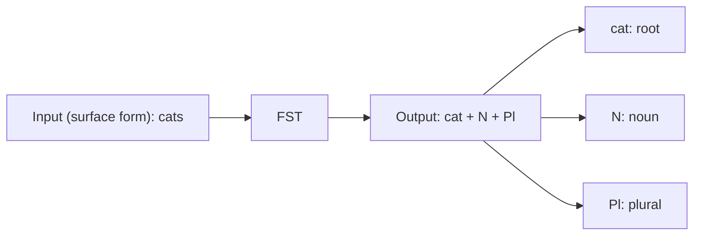

**In simple words:** morphological analysis turns a word into its root plus tags; a finite state transducer (FST) is the machine that does the turning.

**Output of morphological analysis** (lemma + tags) <Cite id="class-nlp-pyq2" loc="p. 9" />

| Word type | Input word | Morphological analysis (output) |
|---|---|---|
| Regular verb | walked | walk + V + Past |
| Irregular verb | went | go + V + Past |
| Singular noun | cat | cat + N + Sg |
| Plural noun | cats | cat + N + Pl |

Went gives go because the lemma of the irregular form is go, so the analyser needs a dictionary. <Cite id="class-nlp-pyq2" loc="p. 9" />

**FST:** an extension of an FSA that maps input sequences to output sequences. An FSA only accepts or rejects; an FST transforms. Each transition has an input symbol and an output symbol. $T = (Q, \Sigma, \Gamma, q_0, F)$: $Q$ states, $\Sigma$ input alphabet, $\Gamma$ output alphabet, $q_0$ initial state, $F$ final states. <Cite id="class-nlp-pyq2" loc="p. 9" />

**Role in morphological parsing:** it maps the surface form of a word to its morphological representation (root or stem plus noun, verb, singular, plural, tense): surface word, then FST, then morphological analysis. <Cite id="class-nlp-pyq2" loc="p. 10" />

**Example:** cats goes in, and cat + N + Pl comes out, where cat is the root, N is noun and Pl is plural. <Cite id="class-nlp-pyq2" loc="p. 10" />

**Conclusion:** the FST gives both directions of the job: word to analysis for parsing, and analysis to word for generation.
