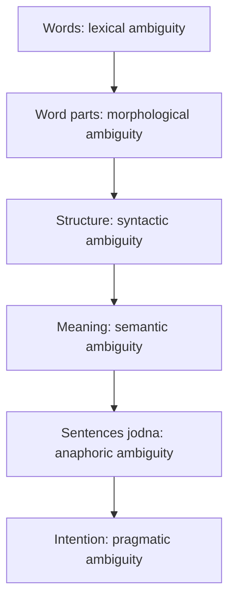

**In simple words:** sentence **ambiguous** tab hota hai jab use ek se zyada tareeke se padha ja sake. Ambiguity language processing ke har level pe aa sakti hai, aur computer ko sahi reading chunni padti hai. <Cite id="ambiguity-challenges-gfg-ambiguity" /> <Cite id="ambiguity-challenges-tp-ambiguities" />

| Level | Ambiguity ka kind | Example | Do readings |
|---|---|---|---|
| Lexical | ek word, kai senses (POS bhi: *can* noun ya verb) | "I went to the **bank**." | money bank ya river bank <Cite id="ambiguity-challenges-wiki-polysemy" /> |
| Morphological | word do tareeke se parts mein tootta hai | *unlockable* | un + lockable (lock nahi ho sakta) ya unlock + able (unlock ho sakta hai) |
| Syntactic (structural) | ek sentence, do parse trees | "I saw the man with a telescope." | maine telescope se dekha, ya aadmi ke paas telescope tha <Cite id="ambiguity-challenges-wiki-synamb" /> |
| Semantic | ek parse ke baad bhi poore ka meaning unclear | "Every student read a book." | sabke liye ek hi book, ya sabki alag book |
| Anaphoric (discourse) | pronoun ke kai possible antecedents | "Ravi told Amit that he had won." | *he* = Ravi ya Amit |
| Pragmatic | asli intention words se alag hai | "Can you pass the salt?" | ability ka sawaal, ya request |

**Inhe kaise resolve karte hain**

- Lexical: POS tagging aur context se word sense disambiguation.
- Syntactic: probabilistic parsing sabse likely tree chunta hai.
- Semantic: world knowledge aur selectional restrictions (*eat* ko food chahiye).
- Anaphoric: reference resolution (Hobbs, Centering).
- Pragmatic: dialogue context aur speaker ke goals. <Cite id="ambiguity-challenges-slp3" />

**Conclusion:** ambiguity lexical, morphological, syntactic, semantic, anaphoric aur pragmatic levels pe aati hai, aur NLP systems context aur probability se intended meaning chunte hain.
