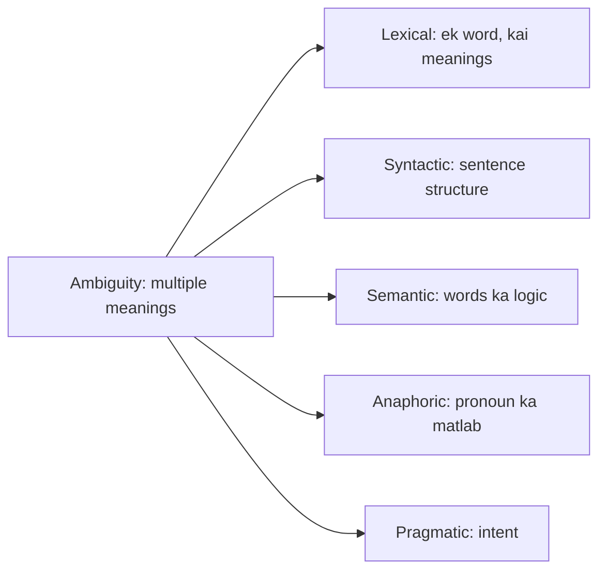

**In simple words:** ambiguity matlab ek word, sentence ya phrase ke ek se zyada meanings. NLP ko context se sahi meaning chunna padta hai.

**Definition:** ambiguity in NLP is a word, sentence or phrase with multiple meanings. Example: "I saw a man with telescope" (telescope kiske paas hai?). <Cite id="class-nlp-m1" loc="p. 3" />

**Types, examples ke saath** <Cite id="class-nlp-m1" loc="p. 3" /> <Cite id="class-nlp-m1" loc="p. 4" /> <Cite id="class-nlp-m1" loc="p. 6" /> <Cite id="class-nlp-m1" loc="p. 7" />

| Type | Kya unclear hai | Example (do meanings) | Kaise resolve karein |
|---|---|---|---|
| Lexical | Ek word ke kai meanings | "He deposited money in the bank": financial bank ya river bank | Word Sense Disambiguation |
| Syntactic | Sentence ka structure | "Visiting relatives can be boring": hum unse milne jaate hain ya wo humse milne aate hain | Parsing aur syntactic disambiguation rules |
| Semantic | Structure clear hai, logic nahi | "Someone ate every slice of pizza": ek insaan ne sab khaya, ya har slice kisi ne khayi | Meaning aur context use karo |
| Anaphoric | Pronoun ek se zyada nouns ki taraf point kar sakta hai | "Mary told Susan that she had won": Mary ya Susan | Pronoun resolution (Hobbs, centering) |
| Pragmatic | Literal meaning clear hai, intent alag | "Do you know the time?": haan ya na, ya mujhe time batao | Context, tone aur speaker ki intention |

Resolution column ke sources: <Cite id="class-nlp-pyq4" loc="p. 6" /> <Cite id="class-nlp-asol" loc="p. 1" /> <Cite id="class-nlp-asol" loc="p. 3" />. Semantic ka remedy ek-line standard answer hai (class files ise work out nahi karti).

**Conclusion:** ambiguity context dekhkar solve hoti hai, aur har type ka apna method hai: words ke liye WSD, structure ke liye parsing, references ke liye pronoun resolution.
