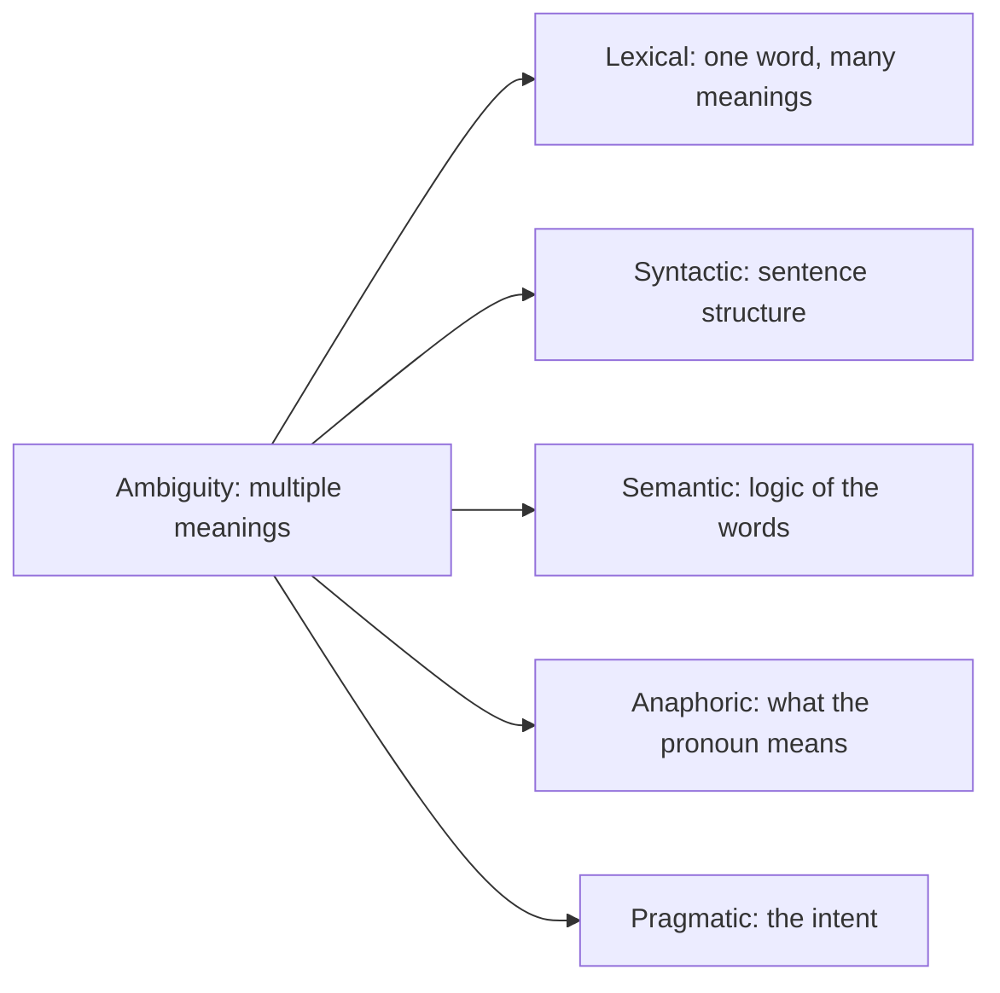

**In simple words:** ambiguity means a word, sentence or phrase has more than one meaning. NLP must pick the right one using context.

**Definition:** ambiguity in NLP is a word, sentence or phrase with multiple meanings. Example: "I saw a man with telescope" (who has the telescope?). <Cite id="class-nlp-m1" loc="p. 3" />

**Types, with examples** <Cite id="class-nlp-m1" loc="p. 3" /> <Cite id="class-nlp-m1" loc="p. 4" /> <Cite id="class-nlp-m1" loc="p. 6" /> <Cite id="class-nlp-m1" loc="p. 7" />

| Type | What is unclear | Example (two meanings) | How to resolve |
|---|---|---|---|
| Lexical | One word has several meanings | "He deposited money in the bank": financial bank or river bank | Word Sense Disambiguation |
| Syntactic | The structure of the sentence | "Visiting relatives can be boring": we visit them or they visit us | Parsing and syntactic disambiguation rules |
| Semantic | Structure is clear, logic is not | "Someone ate every slice of pizza": one person ate all, or each slice was eaten by someone | Use meaning and context |
| Anaphoric | A pronoun can point to more than one noun | "Mary told Susan that she had won": Mary or Susan | Pronoun resolution (Hobbs, centering) |
| Pragmatic | Literal meaning is clear, intent differs | "Do you know the time?": yes or no, or tell me the time | Context, tone and the speaker's intention |

Sources of the resolution column: <Cite id="class-nlp-pyq4" loc="p. 6" /> <Cite id="class-nlp-asol" loc="p. 1" /> <Cite id="class-nlp-asol" loc="p. 3" />. The semantic remedy is a one-line standard answer (the class files do not work it out).

**Conclusion:** ambiguity is solved by looking at context, and each type has its own method: WSD for words, parsing for structure, pronoun resolution for references.
