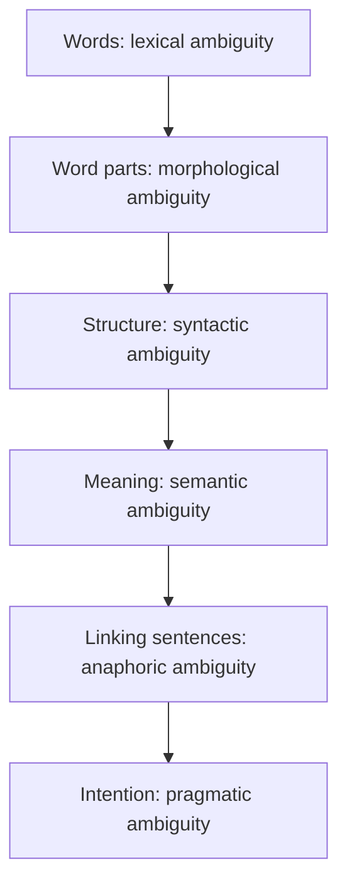

**In simple words:** a sentence is **ambiguous** when it can be read in more than one way. Ambiguity can occur at every level of language processing, and the computer must pick the right reading. <Cite id="ambiguity-challenges-gfg-ambiguity" /> <Cite id="ambiguity-challenges-tp-ambiguities" />

| Level | Kind of ambiguity | Example | Two readings |
|---|---|---|---|
| Lexical | one word, many senses (also POS: *can* noun or verb) | "I went to the **bank**." | money bank or river bank <Cite id="ambiguity-challenges-wiki-polysemy" /> |
| Morphological | a word splits into parts in two ways | *unlockable* | un + lockable (cannot be locked) or unlock + able (can be unlocked) |
| Syntactic (structural) | one sentence, two parse trees | "I saw the man with a telescope." | I used a telescope, or the man had one <Cite id="ambiguity-challenges-wiki-synamb" /> |
| Semantic | the meaning of the whole is unclear even with one parse | "Every student read a book." | the same book for all, or each a different book |
| Anaphoric (discourse) | a pronoun has several possible antecedents | "Ravi told Amit that he had won." | *he* = Ravi or Amit |
| Pragmatic | the real intention is not what the words say | "Can you pass the salt?" | a question about ability, or a request |

**How they are resolved**

- Lexical: POS tagging and word sense disambiguation using context.
- Syntactic: probabilistic parsing picks the most likely tree.
- Semantic: world knowledge and selectional restrictions (*eat* needs food).
- Anaphoric: reference resolution (Hobbs, Centering).
- Pragmatic: dialogue context and speaker goals. <Cite id="ambiguity-challenges-slp3" />

**Conclusion:** ambiguity appears at the lexical, morphological, syntactic, semantic, anaphoric and pragmatic levels, and NLP systems use context and probability to choose the intended meaning.
