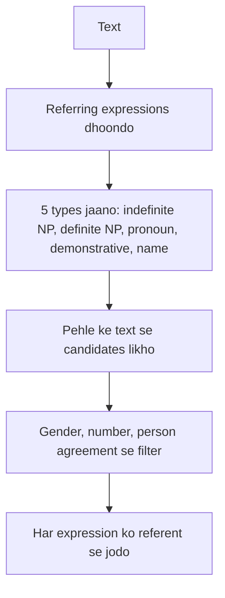

**In simple words:** reference resolution ka kaam hai ye dhoondhna ki har referring expression (*he*, *it*, *the book*, *Ram*) kis cheez ko point karta hai, taaki text ke sentences ek meaning mein jud jaayein. <Cite id="class-nlp-asol" loc="p. 4" />

**Definition:** **referring expression** wo word ya phrase hai jo kisi insaan, object ya idea ko point karta hai. Uska **referent** wo cheez hai jise wo point karta hai. Agar wo peeche ke kisi phrase ko point kare, to wo phrase **antecedent** hai. **Reference resolution** har referring expression ka referent ya antecedent dhoondhta hai.

**Why it is needed:** har sentence simple ho sakta hai, par baad ke sentences pehle se mention ki gayi cheezon ke liye pronouns aur chhote names use karte hain. "Taylor went to the store. She bought groceries." mein program ko pata hona chahiye ki *She* matlab *Taylor*. Isse references aur meanings sahi interpret hote hain. <Cite id="class-nlp-asol" loc="p. 1" />

**Resolve hone wale paanch types.** Indefinite NPs (*some food*) kuch naya laate hain, isliye unka pehle ka antecedent nahi hota. Definite NPs (*The Times of India*), pronouns (*he*), demonstratives (*this*, *that*) aur names (*Ram*) known cheezon ko point karte hain. Pronouns sabse mushkil hain, kyunki unka apna meaning kam hota hai aur wo context pe depend karte hain. <Cite id="class-nlp-asol" loc="p. 4" /> <Cite id="class-nlp-asol" loc="p. 5" />

**Methods:** class ke do algorithms pronouns resolve karte hain. **Hobbs algorithm** syntactic tree mein nouns dhoondhta hai aur gender, number aur distance se filter karta hai. **Centering algorithm** har sentence ka focus track karta hai aur wo antecedent prefer karta hai jo focus rakhe. <Cite id="class-nlp-asol" loc="p. 2" /> <Cite id="class-nlp-asol" loc="p. 3" />

**Agreement check (class files mein nahi):** pronoun aur antecedent number, person, case aur gender mein match karne chahiye.

**Conclusion:** reference resolution discourse ke sentences ko jodta hai aur translation, summarization aur question answering ke liye zaroori hai.
