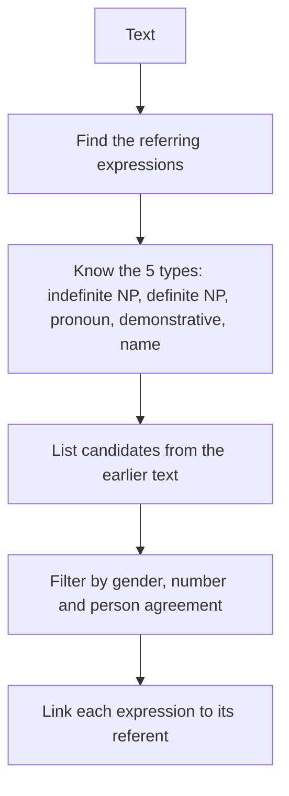

**In simple words:** reference resolution is the job of finding what each referring expression (*he*, *it*, *the book*, *Ram*) points to, so that the sentences of a text link up into one meaning. <Cite id="class-nlp-asol" loc="p. 4" />

**Definition:** a **referring expression** is a word or phrase used to point to a person, object or idea. Its **referent** is the thing it points to. If it points back to an earlier phrase, that phrase is the **antecedent**. **Reference resolution** finds the referent or antecedent of every referring expression.

**Why it is needed:** each sentence may be simple, but later sentences use pronouns and short names for things already mentioned. In "Taylor went to the store. She bought groceries.", the program must know that *She* is *Taylor*. This helps interpret references and meanings correctly. <Cite id="class-nlp-asol" loc="p. 1" />

**The five types to resolve.** Indefinite NPs (*some food*) bring in something new, so they have no earlier antecedent. Definite NPs (*The Times of India*), pronouns (*he*), demonstratives (*this*, *that*) and names (*Ram*) point to known things. Pronouns are the hardest, because they carry little meaning of their own and depend on context. <Cite id="class-nlp-asol" loc="p. 4" /> <Cite id="class-nlp-asol" loc="p. 5" />

**Methods:** two class algorithms resolve pronouns. The **Hobbs algorithm** searches the syntactic tree for nouns and filters them by gender, number and distance. The **Centering algorithm** tracks the focus of each sentence and prefers the antecedent that keeps the focus. <Cite id="class-nlp-asol" loc="p. 2" /> <Cite id="class-nlp-asol" loc="p. 3" />

**Agreement check (not in the class files):** a pronoun and its antecedent must match in number, person, case and gender.

**Conclusion:** reference resolution connects the sentences of a discourse and is needed for translation, summarization and question answering.
