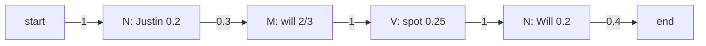

**In simple words:** Hidden Markov Model (HMM) tagger tags ko hidden states aur words ko dikhne wali cheez maanta hai. Do tables counting se seekhte hain: **transition** $P(t_i \mid t_{i-1})$ (ek tag ke baad dusra tag kitna likely hai) aur **emission** $P(w_i \mid t_i)$ (ek tag se word kitna likely hai). Phir **Viterbi** algorithm best tag sequence dhundhta hai. Yahan `Will`/`will` aur `Spot`/`spot` ko same word maana gaya hai. <Cite id="class-nlp-pyq3" loc="p. 7" />

<Sum>

<Given>

chaar sentences, tags N (noun), M (modal), V (verb): Martin/N Justin/N can/M watch/V Will/N; Spot/N will/M watch/V Martin/N; Will/N Justin/N spot/V Martin/N; Martin/N will/M pat/V Spot/N. Test sentence: *Justin will spot Will*.

</Given>

<Find>

transition matrix, emission matrix, aur test sentence ke most likely tags.

</Find>

<Steps>

1. **Tags gino.** N = 3 + 2 + 3 + 2 = 10, M = 3 (can, will, will), V = 4 (watch, watch, spot, pat). Total 17 words. *Reason: ye denominators hain.*
2. **Transitions** $P(t_i \mid t_{i-1}) = C(t_{i-1}, t_i) / C(t_{i-1})$. Chaaron sentences N se shuru hote hain. N se: N ko 2, M ko 3, V ko 1, `<E>` ko 4 (kul 10). M se: V ko 3. V se: N ko 4.

| From \ To | N | M | V | `<E>` |
|---|---|---|---|---|
| `<S>` | 4/4 = 1 | 0 | 0 | 0 |
| N | 2/10 = 0.2 | 3/10 = 0.3 | 1/10 = 0.1 | 4/10 = 0.4 |
| M | 0 | 0 | 3/3 = 1 | 0 |
| V | 4/4 = 1 | 0 | 0 | 0 |

3. **Emissions** $P(w \mid t) = C(t, w) / C(t)$:

| Tag | Martin | Justin | Will | Spot | can | watch | pat |
|---|---|---|---|---|---|---|---|
| N | 4/10 = 0.4 | 2/10 = 0.2 | 2/10 = 0.2 | 2/10 = 0.2 | 0 | 0 | 0 |
| M | 0 | 0 | 2/3 | 0 | 1/3 | 0 | 0 |
| V | 0 | 0 | 0 | 1/4 | 0 | 2/4 = 0.5 | 1/4 |

(*Will/will* do baar noun hai aur do baar modal, aur *Spot/spot* do baar noun aur ek baar verb hai, isliye ye words do rows mein aate hain.)

4. **Viterbi trellis.** Har cell = us tag pe khatam hone wale best path ki probability = (pichla cell) × transition × emission. Start: $P(N \mid \langle S\rangle)=1$.

| Tag | Justin | will | spot | Will |
|---|---|---|---|---|
| N | $1 \times 0.2 = 0.2$ | $0.2 \times 0.2 \times 0.2 = 0.008$ | $0.008 \times 0.2 \times 0.2 = 0.00032$ | $0.01 \times 1 \times 0.2 = 0.002$ (V se) |
| M | 0 | $0.2 \times 0.3 \times \frac23 = 0.04$ | 0 | $0.00032 \times 0.3 \times \frac23 = 0.000064$ |
| V | 0 | 0 | $0.04 \times 1 \times 0.25 = 0.01$ (M se) | 0 |

5. **End.** $0.002 \times P(\langle E\rangle \mid N) = 0.002 \times 0.4 = 0.0008$. M wala cell end nahi ho sakta (M se `<E>` 0 hai). Peeche trace karo: Will V se, spot M se, will N se.

</Steps>

<Answer>

*Justin/N will/M spot/V Will/N*, probability $0.0008$.

</Answer>

<Box kind="verify">

Transition matrix ki row sums 1 hain (N: $0.2+0.3+0.1+0.4$). Winning path seedha multiply karo: $1 \times 0.2 \times 0.3 \times \frac23 \times 1 \times 0.25 \times 1 \times 0.2 \times 0.4 = 0.0008$. Sabse achha rival, N N V N, $0.000016$ deta hai, jo bahut chhota hai. Answer padhne mein bhi natural lagta hai.

</Box>

</Sum>

**Conclusion:** counting se dono matrices milte hain, aur Viterbi sentence ko N M V N tag karta hai.
