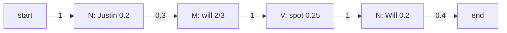

**In simple words:** a Hidden Markov Model (HMM) tagger treats the tags as hidden states and the words as what we see. Two tables are learned by counting: **transition** $P(t_i \mid t_{i-1})$ (how likely a tag follows a tag) and **emission** $P(w_i \mid t_i)$ (how likely a tag produces a word). The **Viterbi** algorithm then finds the best tag sequence. Here `Will`/`will` and `Spot`/`spot` are treated as the same word. <Cite id="pos-tagging-gfg-hmm" /> <Cite id="hmm-maxent-crf-slp3-appA" />

<Sum>

<Given>

four sentences with tags N (noun), M (modal), V (verb): Martin/N Justin/N can/M watch/V Will/N; Spot/N will/M watch/V Martin/N; Will/N Justin/N spot/V Martin/N; Martin/N will/M pat/V Spot/N. Test sentence: *Justin will spot Will*.

</Given>

<Find>

the transition matrix, the emission matrix, and the most likely tags for the test sentence.

</Find>

<Steps>

1. **Count tags.** N = 3 + 2 + 3 + 2 = 10, M = 3 (can, will, will), V = 4 (watch, watch, spot, pat). Total 17 words. *Reason: these are the denominators.*
2. **Transitions** $P(t_i \mid t_{i-1}) = C(t_{i-1}, t_i) / C(t_{i-1})$. All 4 sentences start with N. From N: to N 2, to M 3, to V 1, to `<E>` 4 (10 in all). From M: to V 3. From V: to N 4.

| From \ To | N | M | V | `<E>` |
|---|---|---|---|---|
| `<S>` | 4/4 = 1 | 0 | 0 | 0 |
| N | 2/10 = 0.2 | 3/10 = 0.3 | 1/10 = 0.1 | 4/10 = 0.4 |
| M | 0 | 0 | 3/3 = 1 | 0 |
| V | 4/4 = 1 | 0 | 0 | 0 |

3. **Emissions** $P(w \mid t) = C(t, w) / C(t)$:

| Tag | Martin | Justin | Will | Spot | can | watch | pat |
|---|---|---|---|---|---|---|---|
| N | 4/10 = 0.4 | 2/10 = 0.2 | 2/10 = 0.2 | 2/10 = 0.2 | 0 | 0 | 0 |
| M | 0 | 0 | 2/3 | 0 | 1/3 | 0 | 0 |
| V | 0 | 0 | 0 | 1/4 | 0 | 2/4 = 0.5 | 1/4 |

(*Will/will* is a noun twice and a modal twice, and *Spot/spot* is a noun twice and a verb once, so each of these words appears in two rows.)

4. **Viterbi trellis.** Each cell = best path probability ending in that tag = (previous cell) × transition × emission. Start: $P(N \mid \langle S\rangle)=1$.

| Tag | Justin | will | spot | Will |
|---|---|---|---|---|
| N | $1 \times 0.2 = 0.2$ | $0.2 \times 0.2 \times 0.2 = 0.008$ | $0.008 \times 0.2 \times 0.2 = 0.00032$ | $0.01 \times 1 \times 0.2 = 0.002$ (from V) |
| M | 0 | $0.2 \times 0.3 \times \frac23 = 0.04$ | 0 | $0.00032 \times 0.3 \times \frac23 = 0.000064$ |
| V | 0 | 0 | $0.04 \times 1 \times 0.25 = 0.01$ (from M) | 0 |

5. **End.** $0.002 \times P(\langle E\rangle \mid N) = 0.002 \times 0.4 = 0.0008$. The M cell cannot end (M to `<E>` is 0). Trace back: Will from V, spot from M, will from N.

</Steps>

<Answer>

*Justin/N will/M spot/V Will/N*, with probability $0.0008$.

</Answer>

<Box kind="verify">

Row sums of the transition matrix are 1 (N: $0.2+0.3+0.1+0.4$). Multiply the winning path directly: $1 \times 0.2 \times 0.3 \times \frac23 \times 1 \times 0.25 \times 1 \times 0.2 \times 0.4 = 0.0008$. The best rival, N N V N, gives $0.000016$, far smaller. The answer also reads naturally.

</Box>

</Sum>

<Cite id="pos-tagging-wiki-viterbi" loc="diagram" />

**Conclusion:** counting gives the two matrices, and Viterbi tags the sentence N M V N. <Cite id="pos-tagging-iiith-hmm" />
