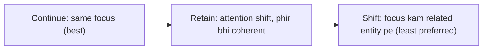

**In simple words:** Centering algorithm track karta hai ki har sentence mainly kis baare mein hai, aur pronoun ko us entity se jodta hai jo focus ko aage chalata hai. <Cite id="class-nlp-asol" loc="p. 1" />

**Definition:** the Centering Algorithm is a central part of Centering Theory in NLP, providing a structured mechanism for tracking the "focus" of discourse and determining how pronouns and references are resolved for natural and coherent text understanding. Ye model karta hai ki discourse coherent kaise rehta hai: har sentence kin entities pe focus karta hai aur focus kaise badalta hai. Ye anaphora resolution ke liye important hai. <Cite id="class-nlp-asol" loc="p. 2" />

**Key concepts**

- **Forward-looking centers (Cf):** utterance (sentence) ki entities, prominence se ranked; subject aam taur pe pehla.
- **Preferred center (Cp):** sabse high-ranked entity, aam taur pe subject.
- **Backward-looking center (Cb):** pichle sentence ki wo entity jis par current sentence sabse zyada centered hai.
- **Transitions:** **Continue** (same focus, preferred), **Retain** (attention shift par coherent), **Shift** (focus kisi dusri, kam related entity pe).

**Steps:** (1) current utterance ka Cf nikaalo; (2) Cp dhoondo; (3) pichle utterance se Cb dhoondo; (4) transitions Continue, Retain, Shift use karo; (5) wo antecedents prefer karo jo centers ki continuity aur prominence rakhein. <Cite id="class-nlp-asol" loc="p. 2" /> <Cite id="class-nlp-asol" loc="p. 3" />

**Example:** "Aragorn picked up the sword. He looked at Frodo." Algorithm *Aragorn* ko backward-looking aur preferred center track karta hai, isliye *He* ko *Aragorn* resolve karta hai. <Cite id="class-nlp-asol" loc="p. 3" />

**Applications:** machine translation, summarization, story generation aur conversational AI, coherent, human-like text banane aur judge karne ke liye.

**Conclusion:** Centering sentence se sentence discourse ka focus follow karke pronouns resolve karta hai.
