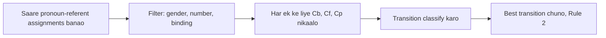

**In simple words:** Centering ek theory hai ki har moment pe text kis cheez ke *baare mein* hai. Ye kehti hai ki har sentence ka ek "center of attention" hota hai, aur pronoun aam taur pe usi entity ko refer karta hai jo pehle se center hai. Grosz, Joshi aur Weinstein (1995) ne theory di; Brennan, Friedman aur Pollard (1987) ne use pronoun resolution algorithm bana diya. <Cite id="discourse-reference-grosz1995" /> <Cite id="anaphora-resolution-bfp1987" />

**Basic terms** sentence $U_n$ ke liye:

- **Cf (forward-looking centers):** $U_n$ ki saari entities, grammatical role se ranked: pehle subject, phir object, phir baaki.
- **Cp (preferred center):** Cf ka top.
- **Cb (backward-looking center):** pichle sentence ke Cf ki sabse high-ranked entity jo $U_n$ mein dobara mention hui. Ye wo "topic" hai jo dono sentences ko jodta hai.

**Transitions** (center ek sentence se doosre mein kaise move karta hai):

| Transition | Cb pichle Cb jaisa? | Cb = Cp? |
|---|---|---|
| Continue | haan | haan |
| Retain | haan | nahi |
| Smooth-shift | nahi | haan |
| Rough-shift | nahi | nahi |

**Rules**

1. **Rule 1:** agar pichle Cf ki koi entity $U_n$ mein pronoun hai, to Cb bhi pronoun hona chahiye.
2. **Rule 2:** transitions ko is order mein prefer karo: Continue > Retain > Smooth-shift > Rough-shift. Text ko ek topic rakhna chahiye aur use dheere se shift karna chahiye.

**Algorithm (Brennan, Friedman, Pollard)**

**Example:** U1 "John saw a beautiful Falcon at the dealership." U2 "**He** showed **it** to Bob." U3 "**He** bought **it**."

- $Cf(U1) = [\text{John, Falcon, dealership}]$. U2 mein *He* = John aur *it* = Falcon se $Cf(U2) = [\text{John, Falcon, Bob}]$, $Cb = $ John (pehle koi Cb nahi, isliye Continue).
- U3 ke liye do options hain. **A:** *He* = John, to $Cb = $ John = Cp aur Cb pehle jaisa: **Continue**. **B:** *He* = Bob, to $Cb = $ Falcon ($Cf(U2)$ mein it, Bob se upar hai), jo purane Cb se alag hai aur Cp = Bob ke barabar nahi: **Rough-shift**.
- Rule 2 Continue ko prefer karta hai, isliye *He* = John.

**Strength:** simple hai aur coherence explain karta hai. **Weakness:** grammar se ranking sirf approximation hai, aur sahi parses aur entity lists chahiye. <Cite id="anaphora-resolution-ibm-coref" />

**Conclusion:** centering pronoun ko wo assignment chunke resolve karta hai jisme sentences ke across center of attention sabse stable rahe.
