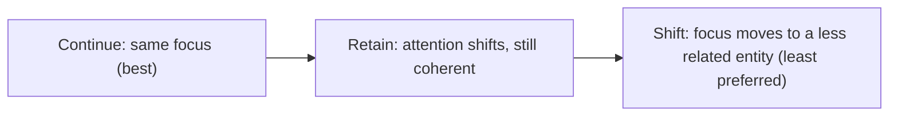

**In simple words:** the Centering algorithm tracks what each sentence is mainly about and resolves a pronoun to the entity that keeps that focus going. <Cite id="class-nlp-asol" loc="p. 1" />

**Definition:** the Centering Algorithm is a central part of Centering Theory in NLP, providing a structured mechanism for tracking the "focus" of discourse and determining how pronouns and references are resolved for natural and coherent text understanding. It models how discourse stays coherent by tracking which entities each sentence focuses on and how the focus shifts. It is important for anaphora resolution. <Cite id="class-nlp-asol" loc="p. 2" />

**Key concepts**

- **Forward-looking centers (Cf):** the entities of an utterance (sentence), ranked by prominence; the subject is usually first.
- **Preferred center (Cp):** the highest-ranked entity, often the subject.
- **Backward-looking center (Cb):** the entity from the previous sentence that the current sentence is most centrally about.
- **Transitions:** **Continue** (same focus, preferred), **Retain** (attention shifts but stays coherent), **Shift** (focus moves to a different, less related entity).

**Steps:** (1) identify Cf of the current utterance; (2) find Cp; (3) find Cb from the previous utterance; (4) use the transitions Continue, Retain, Shift; (5) prefer antecedents that keep the continuity and prominence of centers. <Cite id="class-nlp-asol" loc="p. 2" /> <Cite id="class-nlp-asol" loc="p. 3" />

**Example:** "Aragorn picked up the sword. He looked at Frodo." The algorithm tracks *Aragorn* as the backward-looking and preferred center, so it resolves *He* as *Aragorn*. <Cite id="class-nlp-asol" loc="p. 3" />

**Applications:** machine translation, summarization, story generation and conversational AI, to produce and judge coherent, human-like text.

**Conclusion:** Centering resolves pronouns by following the focus of the discourse from sentence to sentence.
