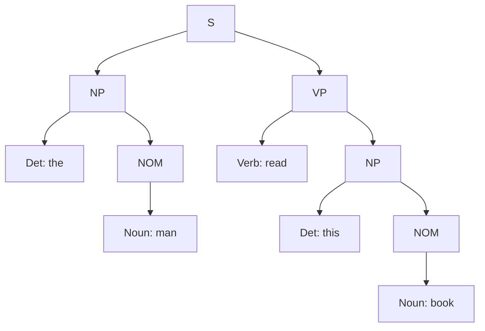

**In simple words:** CYK (Cocke-Younger-Kasami) algorithm check karta hai ki grammar ek sentence bana sakti hai ya nahi. Ye ek triangular table bharta hai: har cell mein wo symbols hote hain jo words ke ek span ko generate kar sakte hain. Iske liye grammar **Chomsky Normal Form (CNF)** mein honi chahiye, jahan har rule $A \to B\,C$ ya $A \to \text{word}$ hota hai. <Cite id="cfg-parsing-gfg-cyk" /> <Cite id="cfg-parsing-wiki-cnf" />

<Sum>

<Given>

sentence "The man read this book" (5 words) aur question wali grammar.

</Given>

<Find>

grammar sentence ko accept karti hai ya nahi, aur uska parse tree.

</Find>

<Steps>

1. **CNF mein convert karo.** `S → Aux NP VP` mein 3 symbols hain, isliye todo: `S → Aux X1`, `X1 → NP VP`. Unit rules `S → VP`, `NOM → Noun` aur `VP → Verb` ko words se replace karo: `S → Verb NP | book | include | read`, `NOM → book | flight | meal | man`, `VP → book | include | read`. Baaki rules (`S → NP VP`, `NP → Det NOM`, `NOM → Noun NOM`, `VP → Verb NP`) pehle se CNF mein hain.
2. **Words (diagonal).** the = Det; man = Noun, NOM; read = Verb, VP, S; this = Det; book = Noun, NOM, Verb, VP, S.
3. **Lambe spans.** Har span ke liye har split point try karo aur aisa rule $A \to B\,C$ dhundho jisme $B$ left cell mein ho aur $C$ right cell mein. Row = start word, column = end word; `·` matlab empty.

| | the | man | read | this | book |
|---|---|---|---|---|---|
| **the** | Det | NP | S, X1 | · | **S, X1** |
| **man** | | Noun, NOM | · | · | · |
| **read** | | | Verb, VP, S | · | VP, S |
| **this** | | | | Det | NP |
| **book** | | | | | Noun, NOM, Verb, VP, S |

- *the man* = Det + NOM se NP (`NP → Det NOM`).
- *this book* = Det + NOM se NP.
- *read this book* = Verb + NP se VP aur S (`VP → Verb NP`, `S → Verb NP`).
- *the man read* = NP + VP se S (`S → NP VP`) aur X1 (`X1 → NP VP`).
- *man read*, *read this*, *man read this*, *the man read this*, *man read this book* ke liye koi rule nahi, isliye empty rehte hain.
- Poora sentence: *man* ke baad split: NP (the man) + VP (read this book) se **S** (`S → NP VP`). X1 bhi aata hai, par wo conversion ka sirf helper symbol hai.

</Steps>

<Answer>

top cell mein **S** hai (aur helper X1), isliye sentence accept hota hai. Parse: [S [NP [Det the] [NOM [Noun man]]] [VP [Verb read] [NP [Det this] [NOM [Noun book]]]]].

</Answer>

<Box kind="verify">

Tree ko original rules se top-down padho: S → NP VP; NP → Det NOM → the NOM; NOM → Noun → man; VP → Verb NP → read NP; NP → Det NOM → this NOM; NOM → Noun → book. Isse "the man read this book" milta hai, aur har rule given grammar mein hai. 5 words ke liye table mein 15 cells hain (5 + 4 + 3 + 2 + 1), aur top cell ka sirf ek split kaam karta hai, isliye sirf ek parse hai.

</Box>

</Sum>

<Cite id="cfg-parsing-wiki-cyk" loc="diagram" />

**Complexity:** $n$ words ke liye $O(n^3 \cdot |G|)$, bottom-up dynamic programming. <Cite id="cfg-parsing-slp3-19" />

**Conclusion:** CYK table ko bottom-up bharta hai, top cell mein S milta hai, isliye "The man read this book" accept hota hai.
