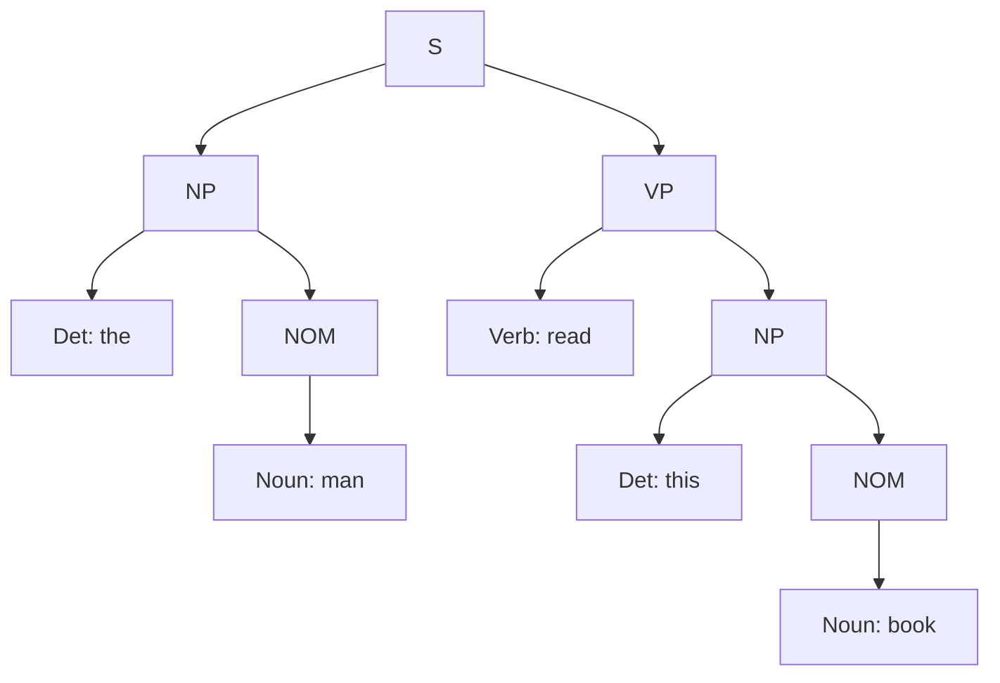

**In simple words:** the CYK (CKY) algorithm checks whether a grammar can produce a sentence by filling a table. Cell $(i, j)$ holds the symbols that can generate the words from $i$ to $j$. The sentence is accepted if S is in the top cell. <Cite id="class-nlp-pyq3" loc="p. 8" />

**Algorithm (as in class):** <Cite id="class-nlp-pyq3" loc="p. 8" />

1. Fill the diagonal $(i = j)$ using the productions that produce each word.
2. For spans of length $L = 2$ to $n$, for each cell $(i, j)$ with $j = i + L - 1$ and every split point $k$ ($i \le k < j$): if there is a production $A \to B\,C$ with $B$ in table$[i][k]$ and $C$ in table$[k+1][j]$, add $A$ to table$[i][j]$.
3. If $S$ is in table$[1][n]$, the grammar generates the string.

CYK works on a grammar in Chomsky Normal Form (every rule is $A \to B\,C$ or $A \to$ a word), so the grammar is first converted.

<Sum>

<Given>

sentence "The man read this book" (5 words) and the grammar in the question.

</Given>

<Find>

whether the grammar accepts the sentence, and its parse tree.

</Find>

<Steps>

1. **Convert to CNF.** `S → Aux NP VP` has 3 symbols, so split it: `S → Aux X1`, `X1 → NP VP`. The unit rules `S → VP`, `NOM → Noun` and `VP → Verb` are replaced by the words themselves: `S → Verb NP | book | include | read`, `NOM → book | flight | meal | man`, `VP → book | include | read`. The other rules (`S → NP VP`, `NP → Det NOM`, `NOM → Noun NOM`, `VP → Verb NP`) are already in CNF.
2. **Words (diagonal).** the = Det; man = Noun, NOM; read = Verb, VP, S; this = Det; book = Noun, NOM, Verb, VP, S.
3. **Longer spans.** For each span, try every split point and look for a rule $A \to B\,C$ with $B$ in the left cell and $C$ in the right cell. Row = start word, column = end word; `·` means empty.

| | the | man | read | this | book |
|---|---|---|---|---|---|
| **the** | Det | NP | S, X1 | · | **S, X1** |
| **man** | | Noun, NOM | · | · | · |
| **read** | | | Verb, VP, S | · | VP, S |
| **this** | | | | Det | NP |
| **book** | | | | | Noun, NOM, Verb, VP, S |

- *the man* = Det + NOM gives NP (`NP → Det NOM`).
- *this book* = Det + NOM gives NP.
- *read this book* = Verb + NP gives VP and S (`VP → Verb NP`, `S → Verb NP`).
- *the man read* = NP + VP gives S (`S → NP VP`) and X1 (`X1 → NP VP`).
- *man read*, *read this*, *man read this*, *the man read this*, *man read this book* have no rule, so they stay empty.
- Whole sentence: split after *man*: NP (the man) + VP (read this book) gives **S** (`S → NP VP`). X1 also appears, but it is only a helper symbol made in the conversion.

</Steps>

<Answer>

the top cell contains **S** (and the helper X1), so the sentence is accepted. Parse: [S [NP [Det the] [NOM [Noun man]]] [VP [Verb read] [NP [Det this] [NOM [Noun book]]]]].

</Answer>

<Box kind="verify">

Read the tree top-down with the original rules: S → NP VP; NP → Det NOM → the NOM; NOM → Noun → man; VP → Verb NP → read NP; NP → Det NOM → this NOM; NOM → Noun → book. This gives "the man read this book", and each rule is in the given grammar. The table has 15 cells for 5 words (5 + 4 + 3 + 2 + 1), and only one split of the top cell works, so there is just one parse.

</Box>

</Sum>

**Conclusion:** CYK fills the table bottom-up, finds S in the top cell, and so accepts "The man read this book".
