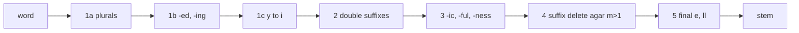

**In simple words:** stemming words ke endings kaat deta hai, taaki *connect, connected, connecting, connection* sab *connect* ban jaayein. **Porter stemmer** (Martin Porter, 1980) ye suffix-stripping rules ki fixed list se karta hai, jo paanch ordered steps mein lagti hai. Search engines isse use karte hain taaki word ke alag forms match ho jaayein. <Cite id="text-preprocessing-porter1980" /> <Cite id="porter-stemmer-gfg-stemming" />

**Basic ideas** <Cite id="porter-stemmer-snowball" />

- Letters vowels (a, e, i, o, u, aur consonant ke baad y) ya consonants hote hain. Har word $[C](VC)^m[V]$ form mein hota hai, aur **$m$ measure hai**, yaani vowel-consonant pairs ki ginti. *tree* $m=0$, *trouble* $m=1$, *troubles* $m=2$.
- Rule aise likha jaata hai: (condition) SUFFIX1 → SUFFIX2. Conditions: $m>0$, $m>1$; `*v*` stem mein vowel hai; `*d` stem double consonant pe khatam hota hai; `*o` stem consonant-vowel-consonant pe khatam hota hai jisme last w, x ya y nahi hai.
- Har step mein sirf sabse lamba matching suffix use hota hai.

<Cite id="porter-stemmer-av-stemming" loc="diagram" />

| Step | Rule | Example |
|---|---|---|
| 1a | SSES→SS, IES→I, SS→SS, S→(nothing) | caresses→caress, ponies→poni, cats→cat |
| 1b | (m>0) EED→EE; (*v*) ED→, ING→ phir tidy: AT→ATE, double letter→single, (m=1 and *o)→add E | agreed→agree, plastered→plaster, hopping→hop |
| 1c | (*v*) Y→I | happy→happi |
| 2 | (m>0) ATIONAL→ATE, TIONAL→TION, IZATION→IZE, FULNESS→FUL, OUSNESS→OUS... | relational→relate |
| 3 | (m>0) ICATE→IC, ATIVE→, ALIZE→AL, FUL→, NESS→ | happiness→happi |
| 4 | (m>1) delete AL, ANCE, ER, IC, ABLE, ANT, MENT, ION, ATE, IVE, IZE... | adjustment→adjust |
| 5 | (m>1) E→; (m=1 and not *o) E→; (m>1 and *d and L) ek L hatao | probate→probat, controll→control |

Examples sirf us step ka result dikhate hain; baad ke steps word ko aur badal sakte hain (jaise *agree* step 5 mein E kho deta hai).

<Sum>

<Given>

words *relational*, *hopping*, *happiness*.

</Given>

<Find>

har ka Porter stem.

</Find>

<Steps>

1. *relational*: step 1 mein change nahi. Step 2: ATIONAL→ATE kyunki stem *rel* ka $m=1>0$: *relate*. Step 3, 4: change nahi (step 4 mein ATE ke liye stem *rel* ka $m>1$ chahiye). Step 5: stem *relat* ka $m=2>1$, to E hatao: *relat*.
2. *hopping*: step 1b: ING hat jaata hai kyunki *hopp* mein vowel hai: *hopp*. Ye double consonant (L, S, Z nahi) pe khatam hota hai, to ek letter hatao: *hop*.
3. *happiness*: step 1a: SS pe khatam, unchanged. Step 3: NESS→ stem *happi* ($m=1>0$) ke saath: *happi*. Aur kuch lagta nahi.

</Steps>

<Answer>

relational → **relat**, hopping → **hop**, happiness → **happi**

</Answer>

<Box kind="verify">

*relat* ka $m$ dobara gino (r-e-l-a-t = C V C V C): pairs *el*, *at*, to $m=2$, jo step 5 allow karta hai. NLTK ka `PorterStemmer` wahi teen stems deta hai.

</Box>

</Sum>

**Advantages:** tez, simple, dictionary nahi chahiye. **Disadvantages:** over-stemming (*university* aur *universe* dono *univers* ban jaate hain), under-stemming, non-words (*happi*), aur sirf English. <Cite id="porter-stemmer-av-stemming" />

**Conclusion:** Porter stemmer paanch ordered steps mein suffixes hatata hai, aur measure $m$ use karke chhote words ko zyada kaatne se bachata hai.
