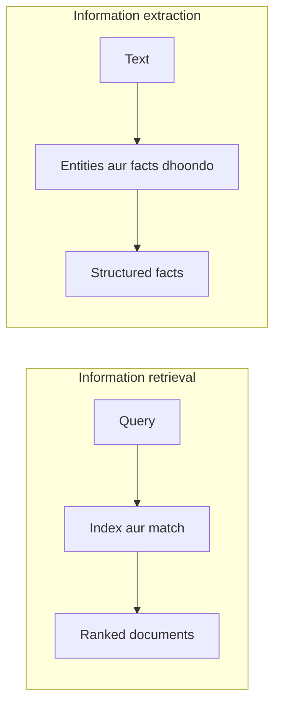

**In simple words:** information retrieval (IR) query se match hone wale **documents** deta hai. Information extraction (IE) text padhkar usme se **facts** nikaalta hai, jaise names, dates aur places. <Cite id="class-nlp-m6" loc="slide 9" /><Cite id="class-nlp-m6" loc="slide 35" /> *(Class files IR aur NER define karti hain par information extraction ko topic ki tarah nahi; neeche ki comparison chhoti aur standard hai.)*

**Information retrieval (IR):** documents ke bade collections mein relevant information dhoondhta hai. Ye documents organize, store, retrieve aur evaluate karta hai, query ko matching function se documents se match karta hai aur retrieval status value (RSV) se rank karta hai. <Cite id="class-nlp-m6" loc="slide 9" />

**Information extraction (IE):** text ke andar ke important facts dhoondhkar unhe structured form mein rakhta hai. Named entity recognition ek typical IE step hai: ye unstructured text ko people, places, organizations aur dates ki structured information banata hai. <Cite id="class-nlp-m6" loc="slide 35" />

| Point | Information retrieval | Information extraction |
|---|---|---|
| Output | documents ki ranked list | structured facts (entities, dates, relations) |
| Question | kaun se documents relevant hain? | text mein kaun se facts hain? |
| Input | query aur document collection | ek text |
| Main steps | acquisition, representation, file organization, matching | tokenizing, POS tagging, entity detection, classification |
| Measured by | relevance ranking (RSV) | nikaale gaye facts sahi hain ya nahi |
| Example | web search engine | news story se names aur dates ki table bharna |

**Conclusion:** IR batata hai information kahan hai; IE information nikaalta hai. Dono saath kaam karte hain, jaise question answering mein.
