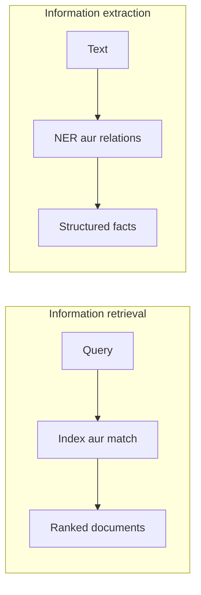

**In simple words:** **Information retrieval (IR)** query ke liye relevant *documents* dhundhta hai, jaise search engine. **Information extraction (IE)** documents padhke unmein se *facts* nikaalta hai, jaise names, dates aur relations, aur table mein daalta hai. IR batata hai "kaun se documents?"; IE batata hai "andar kaun se facts hain?". <Cite id="pyq-2025-05-gfg-ir-ie" /> <Cite id="nlp-applications-gfg-ir" />

**Information retrieval.** User query type karta hai. System document collection ko index karta hai, query ko index se match karta hai, aur ranked list return karta hai. Common models: Boolean, vector space (TF-IDF) aur probabilistic. Ise precision aur recall se judge karte hain. <Cite id="nlp-applications-tp-ir" />

**Information extraction.** System text process karta hai aur structured template bharta hai. Typical steps: tokenization, POS tagging, **named entity recognition**, relation extraction, aur template filling. <Cite id="nlp-applications-gfg-ie" />

| Point | Information retrieval | Information extraction |
|---|---|---|
| Goal | relevant documents dhundhna | text se facts nikaalna |
| Input | query aur document collection | ek text ya document |
| Output | documents ki ranked list | entities aur relations ka table ya template |
| Main techniques | indexing, TF-IDF, ranking | NER, relation extraction, patterns, learning |
| Understanding chahiye | shallow (keywords) | deeper (entities aur roles) |
| Evaluation | precision, recall, ranking measures | extracted items pe precision, recall, F1 |
| Example | "NLP notes" ka Google search | "Tata bought Jaguar in 2008" se (Tata, bought, Jaguar, 2008) |

**Relation:** IR pehle bade collection ko kuch documents tak chhota kar sakta hai, aur IE phir un documents se facts nikaalta hai. <Cite id="pyq-2025-05-wiki-ie" />

**Conclusion:** IR sahi documents dhundhta hai, IE unke andar ke facts; dono aksar saath use hote hain.
