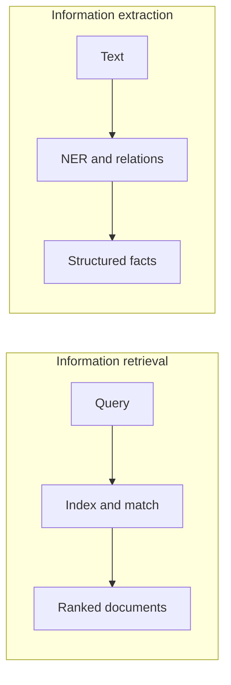

**In simple words:** **Information retrieval (IR)** finds the *documents* that are relevant to a query, like a search engine. **Information extraction (IE)** reads the documents and pulls out *facts* from them, such as names, dates and relations, into a table. IR answers "which documents?"; IE answers "what facts are inside?". <Cite id="pyq-2025-05-gfg-ir-ie" /> <Cite id="nlp-applications-gfg-ir" />

**Information retrieval.** The user types a query. The system indexes the document collection, matches the query against the index, and returns a ranked list. Common models: Boolean, vector space (TF-IDF) and probabilistic. It is judged by precision and recall. <Cite id="nlp-applications-tp-ir" />

**Information extraction.** The system processes the text and fills a structured template. Typical steps: tokenization, POS tagging, **named entity recognition**, relation extraction, and filling the template. <Cite id="nlp-applications-gfg-ie" />

| Point | Information retrieval | Information extraction |
|---|---|---|
| Goal | find relevant documents | extract facts from text |
| Input | a query and a document collection | a text or document |
| Output | ranked list of documents | table or template of entities and relations |
| Main techniques | indexing, TF-IDF, ranking | NER, relation extraction, patterns, learning |
| Understanding needed | shallow (keywords) | deeper (entities and roles) |
| Evaluation | precision, recall, ranking measures | precision, recall, F1 on extracted items |
| Example | Google search for "NLP notes" | from "Tata bought Jaguar in 2008" get (Tata, bought, Jaguar, 2008) |

**Relation:** IR can first narrow a huge collection to a few documents, and IE then extracts facts from those. <Cite id="pyq-2025-05-wiki-ie" />

**Conclusion:** IR finds the right documents, IE finds the facts inside them; the two are often used together.
