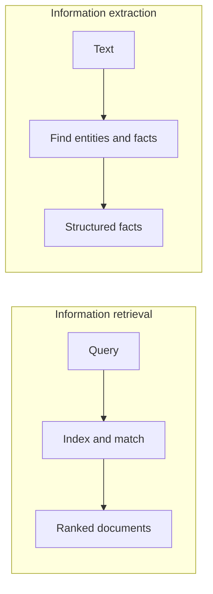

**In simple words:** information retrieval (IR) gives you **documents** that match a query. Information extraction (IE) reads a text and pulls out **facts** from it, such as names, dates and places. <Cite id="class-nlp-m6" loc="slide 9" /><Cite id="class-nlp-m6" loc="slide 35" /> *(The class files define IR and NER but not information extraction as a topic; the comparison below is short and standard.)*

**Information retrieval (IR):** helps to find relevant information from large collections of documents. It organizes, stores, retrieves and evaluates documents, matches a query with documents through a matching function, and ranks them by retrieval status value (RSV). <Cite id="class-nlp-m6" loc="slide 9" />

**Information extraction (IE):** finds important facts inside the text itself and puts them in a structured form. Named entity recognition is a typical IE step: it turns unstructured text into structured information about people, places, organizations and dates. <Cite id="class-nlp-m6" loc="slide 35" />

| Point | Information retrieval | Information extraction |
|---|---|---|
| Output | ranked list of documents | structured facts (entities, dates, relations) |
| Question | which documents are relevant? | what facts does the text state? |
| Input | query and a document collection | a text |
| Main steps | acquisition, representation, file organization, matching | tokenizing, POS tagging, entity detection, classification |
| Measured by | relevance ranking (RSV) | whether the extracted facts are correct |
| Example | a web search engine | filling a table of names and dates from a news story |

**Conclusion:** IR finds where the information is; IE pulls the information out. They work together, for example in question answering.
