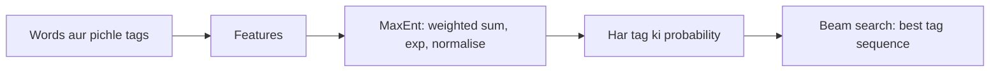

**In simple words:** Maximum Entropy (MaxEnt) tagger har word ko tag deta hai, word aur uske neighbours ke baare mein kai clues (features) dekhkar, aur clue scores ko probabilities mein badal deta hai. Ye ek probabilistic classifier hai jo ek-ek word pe chalta hai, aur pichle tags extra clues ki tarah use hote hain. <Cite id="hmm-maxent-crf-wiki-maxent" /> <Cite id="hmm-maxent-crf-ratnaparkhi1996" />

**Principle:** un sab models mein se jo training data ke dekhe hue facts se match karte hain, wo chuno jiski entropy sabse high ho, yaani jo koi extra assumption na kare. Evidence na ho to saare tags equally likely rehte hain. <Cite id="hmm-maxent-crf-berger1996" />

**Model.** History $h$ (word, aas-paas ke words aur pichle tags) aur tag $t$ ke liye:

$$
P(t \mid h) = \frac{\exp\left(\sum_i \lambda_i f_i(h, t)\right)}{\sum_{t'} \exp\left(\sum_i \lambda_i f_i(h, t')\right)}
$$

Har feature $f_i$ 1 hota hai agar uski condition true ho, warna 0; $\lambda_i$ uska learned weight hai, aur denominator probabilities ko 1 tak add karwata hai.

**POS tagging ke liye features** (Ratnaparkhi, 1996)

| Feature | Fire hone ka example |
|---|---|
| current word aur tag | word = *race*, tag = NN |
| pichle ek aur do tags | previous tag = TO, tag = VB |
| neighbouring words | next word = *the* |
| suffix aur prefix (4 letters tak) | *-ing* pe khatam, tag = VBG |
| capital letter, digit, hyphen | capitalised, tag = NNP |

**Steps**

1. Training: tagged text se features collect karo aur weights $\lambda$ ko iterative scaling ya gradient methods se seekho.
2. Har word ke liye features aur har tag ka $P(t \mid h)$ nikaalo.
3. Poori tag sequence ki probability $\prod_i P(t_i \mid h_i)$ hai. Best sequence **beam search** ya Viterbi se nikaalo. <Cite id="hmm-maxent-crf-slp3-ch18" />

<Sum>

<Given>

(illustrative weights) word *race*, tag TO ke baad. Tag VB: feature "previous tag = TO" weight 1.8 aur feature "word = race" weight 0.4. Tag NN: feature "word = race" weight 1.2 aur feature "previous tag = TO" weight 0.1.

</Given>

<Find>

$P(\text{VB} \mid h)$ aur $P(\text{NN} \mid h)$.

</Find>

<Steps>

1. Scores: VB $= 1.8 + 0.4 = 2.2$; NN $= 1.2 + 0.1 = 1.3$. *Reason: jo features fire hote hain unke weights add karo.*
2. Exponentiate: $e^{2.2} = 9.025$, $e^{1.3} = 3.669$.
3. Normalise: $Z = 9.025 + 3.669 = 12.694$. $P(\text{VB}) = 9.025/12.694 = 0.711$ aur $P(\text{NN}) = 3.669/12.694 = 0.289$.

</Steps>

<Answer>

$P(\text{VB}) \approx 0.711$, $P(\text{NN}) \approx 0.289$, isliye *race* ko VB tag milta hai.

</Answer>

<Box kind="verify">

$0.711 + 0.289 = 1.000$. Doosre tareeke se: $P(\text{VB}) = 1/(1+e^{-(2.2-1.3)}) = 1/(1+e^{-0.9}) = 1/1.4066 = 0.711$.

</Box>

</Sum>

| Point | HMM | MaxEnt |
|---|---|---|
| Type | generative, $P(w, t)$ model karta hai | discriminative, $P(t \mid h)$ model karta hai |
| Features | sirf word aur pichla tag | koi bhi overlapping features (suffix, capital, neighbours) |
| Unknown words | weak | suffix aur shape features se handle |

**Advantage:** rich features; Ratnaparkhi ka tagger Penn Treebank text pe lagbhag 96 percent accuracy tak pahuncha. **Disadvantage:** training slow, aur har decision alag se normalise hota hai, jisse label bias problem aati hai jo CRF fix karta hai. <Cite id="hmm-maxent-crf-gfg-hmm-ml" />

**Conclusion:** MaxEnt tagging weighted features se har tag ko score karta hai, unhe probabilities mein normalise karta hai, aur best sequence beam search se decode karta hai.
