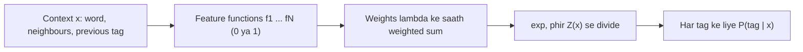

**In simple words:** MaxEnt word aur uske padosi words ke kai clues ko tolkar tag chunta hai, aur facts ke hisaab se jitna ho sake unbiased rehta hai. <Cite id="class-nlp-pyq3" loc="p. 8" />

**Definition:** Maximum Entropy (MaxEnt) model, jise Multinomial Logistic Regression model bhi kehte hain, POS tagging ke liye widely use hone wala discriminative probabilistic framework hai. <Cite id="class-nlp-pyq3" loc="p. 8" />

**HMM versus MaxEnt:** HMM generative hai: wo words aur tags ki joint probability $P(x, y)$ model karta hai. MaxEnt seedhe conditional probability $P(y \mid x)$ model karta hai, yaani context $x$ diya ho to tag $y$ ki probability. <Cite id="class-nlp-pyq3" loc="p. 8" />

**Core idea (maximum entropy principle):** jo pata hai use model karo, aur jo nahi pata uske baare mein uniform uncertainty maano. Training data ke facts se constraints banate hain (jaise word *run* aksar verb hota hai). In constraints ko satisfy karne wali saari probability distributions mein se wo chunte hain jiski entropy maximum ho, yaani sabse uniform aur unbiased, taaki jo observe nahi kiya uske baare mein koi arbitrary assumption na ho. <Cite id="class-nlp-pyq3" loc="p. 8" /> <Cite id="class-nlp-pyq3" loc="p. 9" />

**Feature functions $f_i(x, y)$:** binary indicators (0 ya 1) jo check karte hain ki context par koi condition candidate tag ke liye sach hai ya nahi. Iski taakat ye hai ki ye rich, overlapping, non-independent features use kar sakta hai. <Cite id="class-nlp-pyq3" loc="p. 9" />

| Feature type | Example (sach hone par 1) |
|---|---|
| Current word | word "bank" hai aur tag NN hai |
| Previous tag | pichhla tag DT hai aur tag NN hai |
| Surrounding words | agla word "of" hai aur tag NN hai |
| Morphology | word "-ing" par khatam hota hai aur tag VBG hai |
| Capitalization | word capital se shuru hota hai aur tag NNP hai |

**Formula:**

$$
P(y \mid x) = \frac{1}{Z(x)} \exp\Big(\sum_{i=1}^{N} \lambda_i f_i(x, y)\Big), \qquad Z(x) = \sum_{y'} \exp\Big(\sum_{i=1}^{N} \lambda_i f_i(x, y')\Big)
$$

$\lambda_i$ feature $f_i$ ka seekha hua weight hai (positive tag ki chance badhata hai, negative ghatata hai) aur $Z(x)$ normalization factor hai jo saare tag probabilities ka sum 1 banata hai. <Cite id="class-nlp-pyq3" loc="p. 9" />

**Sequence tagging (MEMM):** poore sentence $W = (w_1, \ldots, w_n)$ ko tags $T = (t_1, \ldots, t_n)$ dene ke liye model ko step by step Maximum Entropy Markov Model ki tarah use karte hain:

$$
P(T \mid W) = \prod_{i=1}^{n} P(t_i \mid x_i)
$$

Context $x_i$ mein current aur aas-paas ke words aur pehle predict kiye tags $t_{i-1}, t_{i-2}$ hote hain. Best tag sequence Viterbi decoding se milta hai. <Cite id="class-nlp-pyq3" loc="p. 10" />

**Limitations** <Cite id="class-nlp-pyq3" loc="p. 10" />

1. **Label bias:** probabilities har step par locally ($Z(x_i)$) normalize hoti hain, poore sentence par nahi, isliye kam outgoing choices wale state se high-probability move haavi ho sakta hai, chahe poora sequence unlikely ho.
2. **Computational cost:** parameter estimation mein iterative optimization (L-BFGS, GIS, IIS) lagta hai, jo HMM ki counting se bhaari hai.

**Conclusion:** MaxEnt ek discriminative model hai jo kai overlapping features milakar tag predict karta hai, label bias aur bhaari training ki keemat par.
