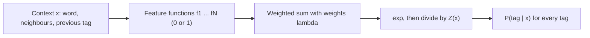

**In simple words:** MaxEnt picks the tag by weighing many clues about the word and its neighbours, and it stays as unbiased as the facts allow. <Cite id="class-nlp-pyq3" loc="p. 8" />

**Definition:** the Maximum Entropy (MaxEnt) model, also known as a Multinomial Logistic Regression model, is a discriminative probabilistic framework widely used for POS tagging. <Cite id="class-nlp-pyq3" loc="p. 8" />

**HMM versus MaxEnt:** an HMM is generative: it models the joint probability $P(x, y)$ of words and tags. MaxEnt directly models the conditional probability $P(y \mid x)$ of a tag $y$ given the context $x$. <Cite id="class-nlp-pyq3" loc="p. 8" />

**Core idea (maximum entropy principle):** model what is known, and assume uniform uncertainty about what is unknown. We set constraints from facts seen in training data (for example, the word *run* is often a verb). Out of all probability distributions that satisfy these constraints, we choose the one with maximum entropy, the most uniform and unbiased one, so no arbitrary assumption is made about what we have not observed. <Cite id="class-nlp-pyq3" loc="p. 8" /> <Cite id="class-nlp-pyq3" loc="p. 9" />

**Feature functions $f_i(x, y)$:** binary indicators (0 or 1) that check whether a condition on the context holds for a candidate tag. Its power is that it can use rich, overlapping, non-independent features. <Cite id="class-nlp-pyq3" loc="p. 9" />

| Feature type | Example (equals 1 when true) |
|---|---|
| Current word | word is "bank" and tag is NN |
| Previous tag | previous tag is DT and tag is NN |
| Surrounding words | next word is "of" and tag is NN |
| Morphology | word ends with "-ing" and tag is VBG |
| Capitalization | word is capitalized and tag is NNP |

**Formula:**

$$
P(y \mid x) = \frac{1}{Z(x)} \exp\Big(\sum_{i=1}^{N} \lambda_i f_i(x, y)\Big), \qquad Z(x) = \sum_{y'} \exp\Big(\sum_{i=1}^{N} \lambda_i f_i(x, y')\Big)
$$

$\lambda_i$ is the learned weight of feature $f_i$ (positive raises the chance of the tag, negative lowers it) and $Z(x)$ is the normalization factor that makes all tag probabilities add up to 1. <Cite id="class-nlp-pyq3" loc="p. 9" />

**Sequence tagging (MEMM):** to tag a whole sentence $W = (w_1, \ldots, w_n)$ with tags $T = (t_1, \ldots, t_n)$, the model is used step by step as a Maximum Entropy Markov Model:

$$
P(T \mid W) = \prod_{i=1}^{n} P(t_i \mid x_i)
$$

The context $x_i$ has the current and surrounding words and the previously predicted tags $t_{i-1}, t_{i-2}$. The best tag sequence is found with Viterbi decoding. <Cite id="class-nlp-pyq3" loc="p. 10" />

**Limitations** <Cite id="class-nlp-pyq3" loc="p. 10" />

1. **Label bias:** probabilities are normalized locally at each step ($Z(x_i)$) instead of over the whole sentence, so a high-probability move from a state with few outgoing choices can dominate even when the whole sequence is unlikely.
2. **Computational cost:** parameter estimation needs iterative optimization (L-BFGS, GIS, IIS), heavier than the counting of an HMM.

**Conclusion:** MaxEnt is a discriminative model that combines many overlapping features to predict the tag, at the cost of label bias and heavier training.
