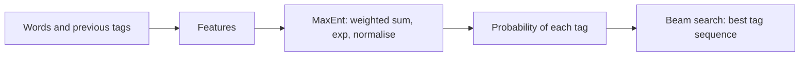

**In simple words:** a Maximum Entropy (MaxEnt) tagger gives each word a tag by looking at many clues (features) about the word and its neighbours, and it turns the clue scores into probabilities. It is a probabilistic classifier used one word at a time, with the earlier tags as extra clues. <Cite id="hmm-maxent-crf-wiki-maxent" /> <Cite id="hmm-maxent-crf-ratnaparkhi1996" />

**The principle:** among all models that match the facts seen in the training data, choose the one with the highest entropy, meaning the one that assumes nothing extra. If there is no evidence, all tags stay equally likely. <Cite id="hmm-maxent-crf-berger1996" />

**Model.** For history $h$ (the word, nearby words and previous tags) and tag $t$:

$$
P(t \mid h) = \frac{\exp\left(\sum_i \lambda_i f_i(h, t)\right)}{\sum_{t'} \exp\left(\sum_i \lambda_i f_i(h, t')\right)}
$$

Each feature $f_i$ is 1 if its condition is true and 0 otherwise, $\lambda_i$ is its learned weight, and the denominator makes the probabilities add to 1.

**Features used for POS tagging** (Ratnaparkhi, 1996)

| Feature | Example that fires |
|---|---|
| current word and tag | word = *race*, tag = NN |
| previous one and two tags | previous tag = TO, tag = VB |
| neighbouring words | next word = *the* |
| suffix and prefix (up to 4 letters) | ends in *-ing*, tag = VBG |
| capital letter, digit, hyphen | capitalised, tag = NNP |

**Steps**

1. Training: collect features from tagged text and learn the weights $\lambda$ by iterative scaling or gradient methods.
2. For each word, compute the features and $P(t \mid h)$ for every tag.
3. The probability of a whole tag sequence is $\prod_i P(t_i \mid h_i)$. Find the best one with **beam search** or Viterbi. <Cite id="hmm-maxent-crf-slp3-ch18" />

<Sum>

<Given>

(illustrative weights) word *race* after tag TO. Tag VB: feature "previous tag = TO" weight 1.8 and feature "word = race" weight 0.4. Tag NN: feature "word = race" weight 1.2 and feature "previous tag = TO" weight 0.1.

</Given>

<Find>

$P(\text{VB} \mid h)$ and $P(\text{NN} \mid h)$.

</Find>

<Steps>

1. Scores: VB $= 1.8 + 0.4 = 2.2$; NN $= 1.2 + 0.1 = 1.3$. *Reason: add the weights of the features that fire.*
2. Exponentiate: $e^{2.2} = 9.025$, $e^{1.3} = 3.669$.
3. Normalise: $Z = 9.025 + 3.669 = 12.694$. $P(\text{VB}) = 9.025/12.694 = 0.711$ and $P(\text{NN}) = 3.669/12.694 = 0.289$.

</Steps>

<Answer>

$P(\text{VB}) \approx 0.711$, $P(\text{NN}) \approx 0.289$, so *race* is tagged VB.

</Answer>

<Box kind="verify">

$0.711 + 0.289 = 1.000$. Another way: $P(\text{VB}) = 1/(1+e^{-(2.2-1.3)}) = 1/(1+e^{-0.9}) = 1/1.4066 = 0.711$.

</Box>

</Sum>

| Point | HMM | MaxEnt |
|---|---|---|
| Type | generative, models $P(w, t)$ | discriminative, models $P(t \mid h)$ |
| Features | word and previous tag only | any overlapping features (suffix, capital, neighbours) |
| Unknown words | weak | handled by suffix and shape features |

**Advantage:** rich features; Ratnaparkhi's tagger reached about 96 percent accuracy on Penn Treebank text. **Disadvantage:** slower training, and each decision is normalised on its own, which causes the label bias problem that CRFs fix. <Cite id="hmm-maxent-crf-gfg-hmm-ml" />

**Conclusion:** MaxEnt tagging scores each tag from weighted features, normalises them to probabilities, and decodes the best sequence with beam search.
