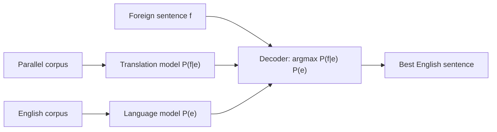

**In simple words:** statistical machine translation (SMT) hand-written rules se nahi, **probability** se translate karta hai. Ye bade **parallel corpus** (do languages mein same text) se seekhta hai ki kaun sa target sentence sabse achha translation hone ke chance rakhta hai. <Cite id="nlp-applications-ibm1993" /> <Cite id="nlp-applications-gfg-mt" />

**Idea (noisy channel).** Foreign sentence $f$ ko English mein translate karne ke liye maan lo ki English sentence $e$ "kharab" hoke $f$ ban gaya, aur best $e$ dhoondho:

$$
\hat{e} = \arg\max_e \; P(f \mid e)\, P(e)
$$

- **Translation model** $P(f \mid e)$: English words dekhte hue foreign words kitne likely hain. Ye parallel corpus se **word alignments** (kaun sa word kis se judta hai) use karke seekha jata hai. Ye *adequacy* deta hai (meaning bani rahe).
- **Language model** $P(e)$: English sentence kitna fluent hai, bade English-only corpus se n-grams ke saath seekha jata hai. Ye *fluency* deta hai.
- **Decoder:** bahut bade candidate sentences mein se sabse zyada product wala dhoondhta hai.

<Cite id="nlp-applications-slp3-13" />

**Advantages:** hand-written rules nahi chahiye; data badhne se behtar hota hai; output fluent. **Disadvantages:** bada parallel corpus chahiye; rare languages aur long-distance word order mein kamzor; zyadatar products mein ab neural translation ne iski jagah le li hai. <Cite id="ambiguity-challenges-wiki-mt" />

**Conclusion:** SMT wo English sentence chunta hai jo faithful translation, $P(f\mid e)$, aur fluent English, $P(e)$, dono ho.
