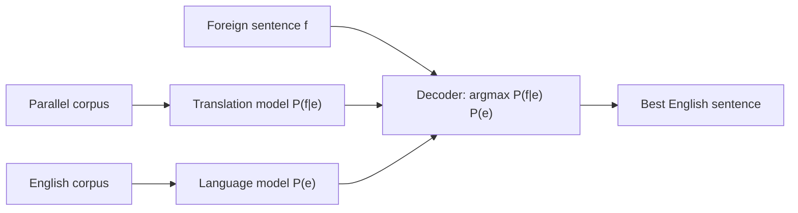

**In simple words:** statistical machine translation (SMT) translates by **probability**, not by hand-written rules. It learns from a large **parallel corpus** (the same text in two languages) which target sentence is most likely to be a good translation. <Cite id="nlp-applications-ibm1993" /> <Cite id="nlp-applications-gfg-mt" />

**Idea (noisy channel).** To translate a foreign sentence $f$ into English, pretend the English sentence $e$ was "corrupted" into $f$ and search for the best $e$:

$$
\hat{e} = \arg\max_e \; P(f \mid e)\, P(e)
$$

- **Translation model** $P(f \mid e)$: how likely the foreign words are, given the English words. It is learned from the parallel corpus using **word alignments** (which word pairs with which). It gives *adequacy* (the meaning is kept).
- **Language model** $P(e)$: how fluent the English sentence is, learned from a large English-only corpus with n-grams. It gives *fluency*.
- **Decoder:** searches the huge space of candidate sentences for the highest product.

<Cite id="nlp-applications-slp3-13" />

**Advantages:** no hand-written rules; improves with more data; fluent output. **Disadvantages:** needs a big parallel corpus; weak for rare languages and long-distance word order; has been replaced by neural translation in most products. <Cite id="ambiguity-challenges-wiki-mt" />

**Conclusion:** SMT picks the English sentence that is both a faithful translation, $P(f\mid e)$, and fluent English, $P(e)$.
