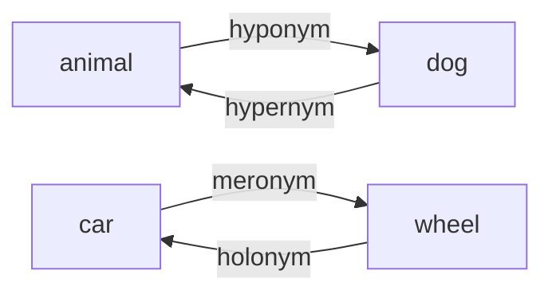

**In simple words:** ye relations words ko ek doosre ke upar, neeche ya andar rakhti hain. <Cite id="class-nlp-pyq4" loc="p. 1" />

1. **Hyponymy:** ek hierarchical ("inclusion") relationship jisme ek specific lexeme ki meaning ek zyaada general lexeme ki meaning ke andar aati hai. General term hypernym hai aur specific term hyponym. *Example:* dog, animal ka hyponym hai, aur rose, flower ka hyponym. <Cite id="class-nlp-pyq4" loc="p. 1" />

2. **Hypernymy:** hyponymy ka ulta. Ek general, broader lexeme specific lexemes ki meaning ko cover karta hai; upar wala term hypernym ("superordinate" term) kehlata hai. *Example:* animal, dog, cat aur elephant ka hypernym hai; furniture, chair aur table ka hypernym hai. <Cite id="class-nlp-pyq4" loc="p. 2" />

3. **Meronymy:** lexemes ke beech part-whole relationship: ek word us object ka ek hissa batata hai jo doosra word batata hai. *Example:* wheel, car ka meronym hai; page, book ka meronym hai. <Cite id="class-nlp-pyq4" loc="p. 1" />

4. **Holonymy:** meronymy ka ulta: wo word jo us poori cheez ko batata hai jiska ye part hai. *Example:* car, wheel ka holonym hai; book, page ka holonym hai. (Class answer meronymy deta hai; holonymy uska ulta hai.)

**Conclusion:** hyponymy aur hypernymy is-a ki jodi hain; meronymy aur holonymy part-whole ki jodi.
