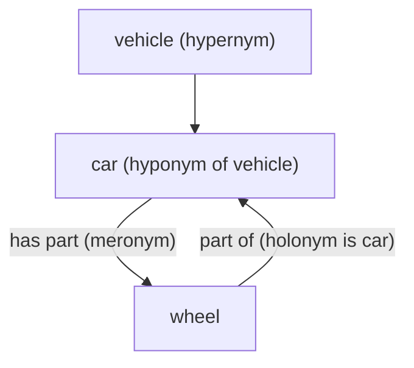

**In simple words:** words meaning ke hisaab se ek doosre se jude hote hain, aur WordNet ye links store karta hai. Do links **kind-of** ke hain (hyponymy aur hypernymy) aur do **part-of** ke (meronymy aur holonymy). <Cite id="lexical-semantics-slp3-appI" /> <Cite id="lexical-semantics-gfg-semantic" />

- **Hyponymy (kind-of, neeche):** zyada specific word. *Sparrow*, *bird* ka hyponym hai; *dog*, *animal* ka hyponym hai. Test: "A sparrow is a kind of bird." <Cite id="lexical-semantics-wiki-hyponymy" />
- **Hypernymy (kind-of, upar):** zyada general word. *Bird*, *sparrow* ka hypernym hai; *vehicle*, *car* ka hypernym hai. Hyponymy aur hypernymy ek hi link hai, bas dono sire se dekha gaya.
- **Meronymy (part-of, neeche):** part ka word. *Wheel*, *car* ka meronym hai; *finger*, *hand* ka meronym hai. Test: "A wheel is a part of a car." <Cite id="lexical-semantics-wiki-meronymy" />
- **Holonymy (part-of, upar):** poore ka word. *Car*, *wheel* ka holonym hai; *tree*, *branch* ka holonym hai. Ye bhi wahi link hai, doosre sire se.

| Pair | Meaning | Example |
|---|---|---|
| Hyponym to hypernym | specific to general | sparrow to bird |
| Hypernym to hyponym | general to specific | bird to sparrow |
| Meronym to holonym | part to whole | wheel to car |
| Holonym to meronym | whole to part | car to wheel |

**Conclusion:** hyponym/hypernym "is-a" batate hain aur meronym/holonym "part-of"; in links se system ek word se related words tak reasoning kar sakta hai.
