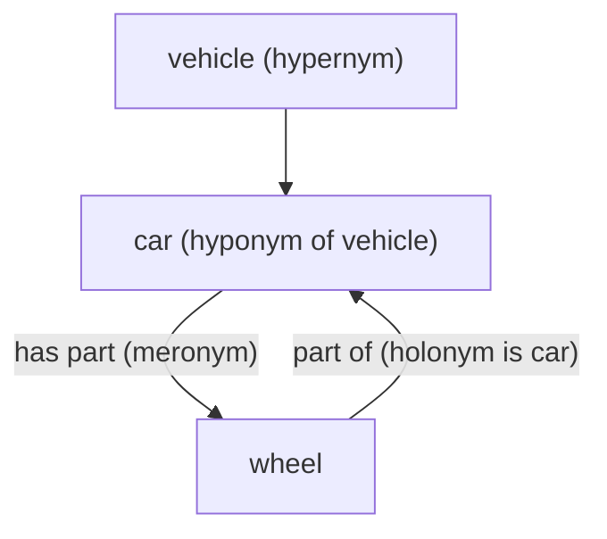

**In simple words:** words are linked to each other by meaning, and WordNet stores these links. Two links are about **kind-of** (hyponymy and hypernymy) and two are about **part-of** (meronymy and holonymy). <Cite id="lexical-semantics-slp3-appI" /> <Cite id="lexical-semantics-gfg-semantic" />

- **Hyponymy (kind-of, going down):** the more specific word. *Sparrow* is a hyponym of *bird*; *dog* is a hyponym of *animal*. Test: "A sparrow is a kind of bird." <Cite id="lexical-semantics-wiki-hyponymy" />
- **Hypernymy (kind-of, going up):** the more general word. *Bird* is a hypernym of *sparrow*; *vehicle* is a hypernym of *car*. Hyponymy and hypernymy are the same link seen from the two ends.
- **Meronymy (part-of, going down):** the word for a part. *Wheel* is a meronym of *car*; *finger* is a meronym of *hand*. Test: "A wheel is a part of a car." <Cite id="lexical-semantics-wiki-meronymy" />
- **Holonymy (part-of, going up):** the word for the whole. *Car* is a holonym of *wheel*; *tree* is a holonym of *branch*. Again the same link seen from the other end.

| Pair | Meaning | Example |
|---|---|---|
| Hyponym to hypernym | specific to general | sparrow to bird |
| Hypernym to hyponym | general to specific | bird to sparrow |
| Meronym to holonym | part to whole | wheel to car |
| Holonym to meronym | whole to part | car to wheel |

**Conclusion:** hyponym/hypernym describe "is-a" and meronym/holonym describe "part-of"; these links let a system reason from one word to related words.
