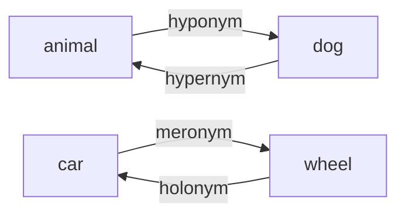

**In simple words:** these relations place words above, below or inside each other. <Cite id="class-nlp-pyq4" loc="p. 1" />

1. **Hyponymy:** a hierarchical ("inclusion") relationship where the meaning of a specific lexeme is included within the meaning of a more general lexeme. The general term is the hypernym and the specific term is the hyponym. *Example:* dog is a hyponym of animal, and rose is a hyponym of flower. <Cite id="class-nlp-pyq4" loc="p. 1" />

2. **Hypernymy:** the inverse of hyponymy. A general, broader lexeme encompasses the meaning of more specific lexemes; the overarching term is the hypernym (a "superordinate" term). *Example:* animal is the hypernym of dog, cat and elephant; furniture is the hypernym of chair and table. <Cite id="class-nlp-pyq4" loc="p. 2" />

3. **Meronymy:** a part-whole relationship between lexemes: one word denotes a constituent part of the object denoted by another word. *Example:* wheel is a meronym of car; page is a meronym of book. <Cite id="class-nlp-pyq4" loc="p. 1" />

4. **Holonymy:** the inverse of meronymy: the word for the whole that has the part. *Example:* car is the holonym of wheel; book is the holonym of page. (The class answer gives meronymy; holonymy is its reverse.)

**Conclusion:** hyponymy and hypernymy are the is-a pair; meronymy and holonymy are the part-whole pair.
