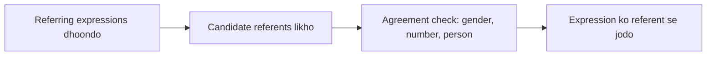

**In simple words:** reference resolution matlab ye dhoondhna ki *he*, *it* ya *the book* jaisa har word kis cheez ko point karta hai. Ye ek hi cheez ke saare mentions ko jodta hai.

**Definition:** referring expression wo word ya phrase hai jo kisi insaan, object ya idea ko point karta hai; uska **referent** wo cheez hai jise wo point karta hai. Jab wo peeche ke kisi phrase ko point karta hai, to wo phrase **antecedent** hai. **Reference resolution** har referring expression ka referent ya antecedent dhoondhne ka task hai. <Cite id="class-nlp-asol" loc="p. 4" />

**Example:** "Ram laughed as loud as he could." Pronoun *he* peeche name *Ram* ko refer karta hai, isliye *he* = *Ram*. <Cite id="class-nlp-asol" loc="p. 5" />

**Why it is needed:** "She bought groceries" tab tak samajh nahi aata jab tak pata na ho ki *She* kaun hai.

**Conclusion:** reference resolution hi text ke sentences ko ek kahani mein jodta hai.
