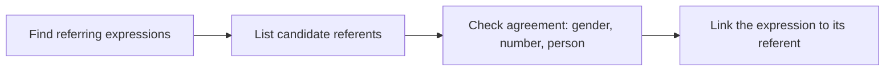

**In simple words:** reference resolution means finding out which thing each word like *he*, *it* or *the book* points to. It links every mention of the same thing together.

**Definition:** a referring expression is a word or phrase used to point to a person, object or idea; its **referent** is the thing it points to. When it points back to an earlier phrase, that phrase is the **antecedent**. **Reference resolution** is the task of finding the referent or antecedent of each referring expression. <Cite id="class-nlp-asol" loc="p. 4" />

**Example:** "Ram laughed as loud as he could." The pronoun *he* refers back to the name *Ram*, so *he* = *Ram*. <Cite id="class-nlp-asol" loc="p. 5" />

**Why it is needed:** "She bought groceries" cannot be understood without knowing who *She* is. 

**Conclusion:** reference resolution is what makes the sentences of a text connect into one story.
