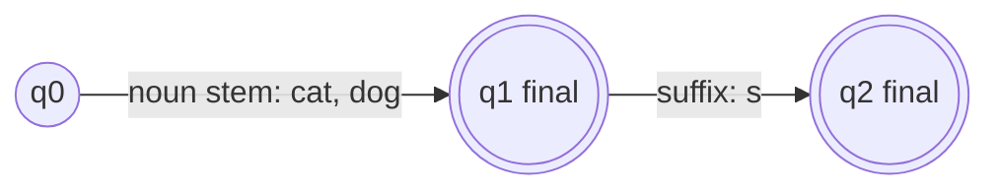
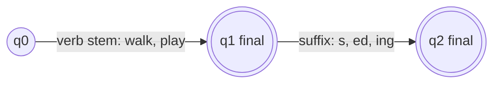
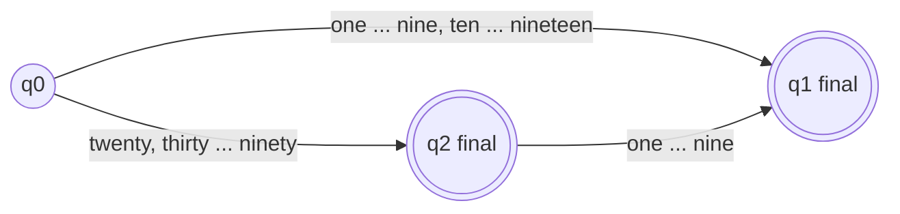

**In simple words:** nouns aur verbs ka FSA ek stem aur phir ek optional ending padhta hai; numbers ka FSA number words ko allowed order mein padhta hai.

**Morphology mein FSA:** states word formation ke stages hain, transitions stems aur affixes hain, aur FSA valid sequence accept karta hai. <Cite id="class-nlp-pyq2" loc="p. 6" /> <Cite id="class-nlp-m2" loc="p. 5" />

**Nouns ka FSA** (stem plus plural -s). Class ke FSAs ka shape wahi hai: stem, phir suffix. <Cite id="class-nlp-m2" loc="p. 5" />

**Verbs ka FSA** (stem plus -s, -ed ya -ing).

Irregular forms (went, mice) lexicon mein store hote hain, kyunki ending rule inhe nahi bana sakta. <Cite id="class-nlp-pyq2" loc="p. 9" />

**English numbers 1 se 99 ka FSA** (standard design; class files mein nahi hai).

| Input | Path | Result |
|---|---|---|
| seven | q0 se q1 | accepted |
| thirteen | q0 se q1 | accepted |
| twenty | q0 se q2 | accepted |
| forty two | q0 se q2 se q1 | accepted |
| twenty thirteen | q2 se thirteen par koi arc nahi | rejected |

**Conclusion:** dono automata ka idea ek hi hai: start state, allowed words order mein padho, final state mein accept.
