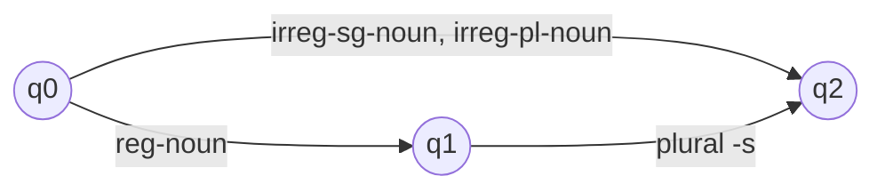
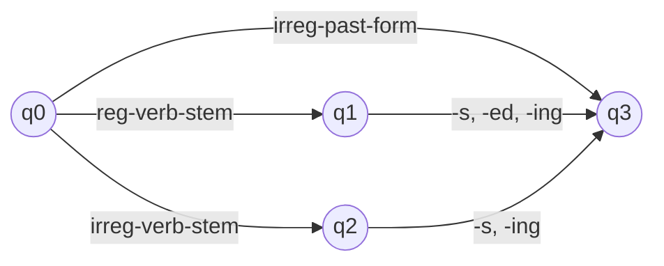
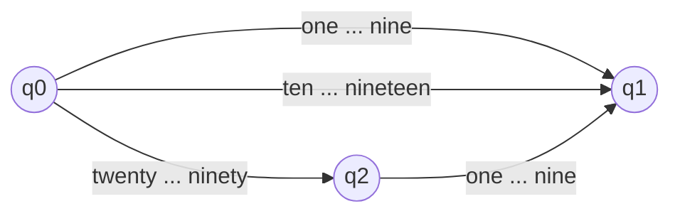

**In simple words:** finite state automaton (FSA) ek machine hai jisme kuch states aur arrows hote hain. Ye word ko ek-ek piece mein padhti hai aur arrows pe chalti hai. Agar **final** (accepting) state pe ruke to word valid hai, warna reject. NLP mein FSA check karta hai ki string legal word hai ya nahi. <Cite id="morphology-fst-gfg-fa" /> <Cite id="morphology-fst-wiki-fsm" />

**Part 1: nouns ke liye FSA.** Noun ek stem hai, aur regular noun plural *-s* le sakta hai. Irregular nouns (*mice*, *goose*) poore list mein rakhe jaate hain. <Cite id="morphology-fst-jm-ch3-notes" />

q1 aur q2 final states hain. Ye *cat*, *cats*, *goose*, *mice* accept karta hai lekin *mices* reject karta hai (irregular plural -s nahi leta).

**Part 2: verbs ke liye FSA.** Regular verb stem -s, -ed, -ing leta hai (*walk, walks, walked, walking*); irregular stem sirf -s aur -ing leta hai; irregular past forms (*ate*) poore list mein hote hain.

q1, q2 aur q3 final hain. Ye *walked* aur *eating* accept karta hai, *eated* reject karta hai.

**Part 3: English numbers 1 se 99 ke liye FSA.** Words ko group karo: **digits** (one se nine), **teens** (ten se nineteen, akele), aur **tens** (twenty, thirty, ..., ninety). Tens word ke baad ek digit aa sakta hai (*twenty-one*).

Final states: q1 aur q2. Accepted: *fifteen*, *forty*, *seventy-four*. Rejected: *twenty-ten* (tens word ke baad teen nahi aa sakta) aur *five-six* (q1 se koi arrow bahar nahi jaata).

| Path | Words accepted |
|---|---|
| q0 to q1 by a digit | 9 |
| q0 to q1 by ten to nineteen | 10 |
| q0 to q2 by a tens word (twenty to ninety, 8 words) | 8 |
| q0 to q2 to q1 (8 tens times 9 digits) | 72 |
| Total | 99 |

Total $9 + 10 + 8 + 72 = 99$, jo 1 se 99 tak ke 99 numbers se match karta hai.

**Conclusion:** wahi chhoti machine idea nouns, verbs aur number words, teeno check karti hai, kyunki teeno pieces ke regular pattern hain.
